# Laporan Praktikum Basis Data - Pertemuan 02

**Nama:** Rizal Hafiz

**NIM:** 25430003

**Kelas:** A

**Pertemuan:** 2

**Dosen/Asisten:** [Dosen: Dedi Irawan,S.Kom., M.T.I]

## 1. Tujuan Praktikum

1. Mengidentifikasi kegiatan organisasi, pihak yang terlibat, dan proses bisnis berdasarkan cerita, wawancara, serta dokumen.
2. Menentukan data yang dibutuhkan, calon entitas, dan aturan bisnis dari dokumen sumber.
3. Membuat matriks CRUD yang menghubungkan proses bisnis dengan data, serta menyusun kamus data yang mencantumkan penanggung jawabnya.
4. Menulis kebutuhan data dan kebutuhan informasi secara jelas, spesifik, dan bisa diuji.

## 2. Ringkasan Dasar Teori

Analisis kebutuhan data perlu dilakukan sebelum merancang basis data agar data yang penting tidak terlewat. Contohnya, jika harga barang saat transaksi tidak disimpan, harga lama bisa hilang ketika harga barang berubah sehingga nilai pada nota lama tidak dapat dipastikan kembali. Data merupakan aset organisasi yang dihasilkan dari kegiatan operasional, sehingga perlu dijaga kualitas dan keakuratannya. Setiap data juga perlu memiliki penanggung jawab yang bertugas memastikan data dikelola dengan baik. Kebutuhan data dapat diketahui melalui wawancara, pengamatan proses kerja, dokumen sumber, dan sistem lama jika tersedia. Aturan bisnis digunakan untuk menetapkan batasan yang harus dipatuhi, sedangkan matriks CRUD menunjukkan proses yang membuat, membaca, memperbarui, atau menghapus data. Kamus data membantu menjelaskan nama, arti, contoh, aturan, dan penanggung jawab setiap elemen data. Sementara itu, pernyataan kebutuhan yang baik harus spesifik, terukur, dan dapat diuji agar hasilnya bisa diperiksa dengan jelas.

## 3. Hasil Langkah Percobaan

### D.1 – Studi Kasus

Studi kasus Kopma digunakan untuk memahami aktivitas operasional koperasi mahasiswa, mulai dari pengelolaan anggota, barang, penjualan, hingga pembelian barang dari pemasok. Analisis dilakukan untuk mengetahui data yang dibutuhkan dalam mendukung transaksi dan penyusunan laporan koperasi.

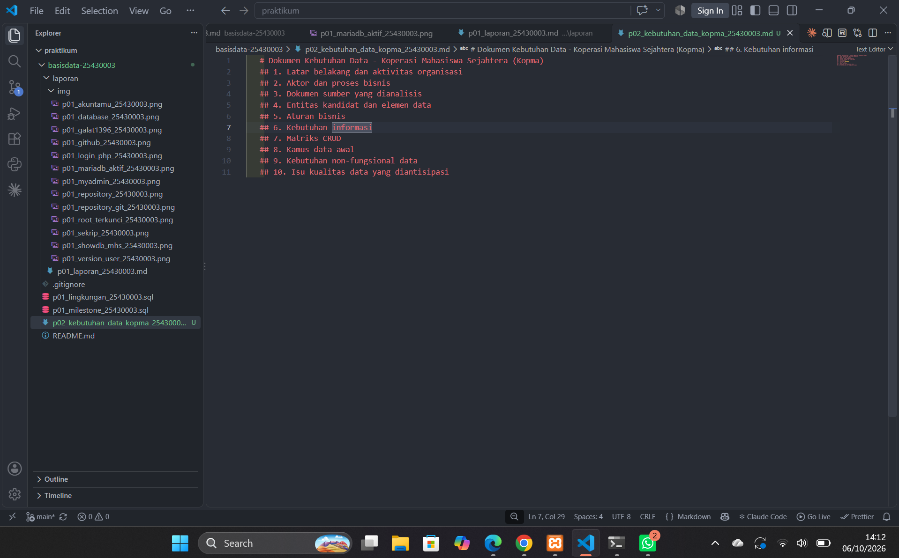

### D.2 – Aktor dan Proses Bisnis

Aktor yang terlibat dalam kegiatan Kopma meliputi kasir, petugas gudang, dan ketua koperasi. Proses bisnisnya mencakup pendaftaran anggota, pencatatan penjualan, pemesanan barang kepada pemasok, penerimaan barang, dan penyusunan laporan bulanan. Setiap proses memiliki pemicu dan tanggung jawab masing-masing sebagai dasar identifikasi kebutuhan data.

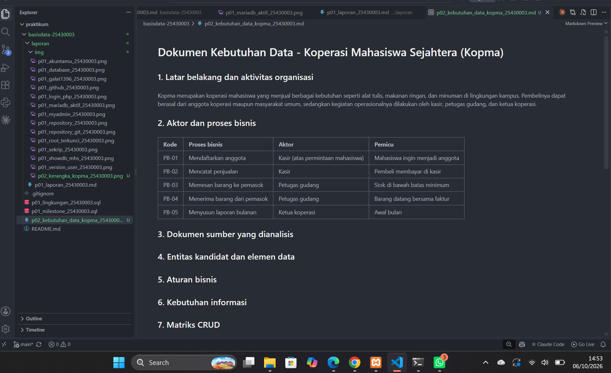

### D.3 – Dokumen Sumber

Dokumen sumber yang dianalisis adalah nota penjualan Kopma pada Gambar 2.5 dalam buku praktikum. Setiap isian pada nota diperiksa untuk menentukan elemen data yang perlu disimpan dan nilai yang dapat dihitung, seperti subtotal dan total. Analisis ini juga dikaitkan dengan kutipan wawancara untuk memahami alasan harga barang saat transaksi perlu dicatat agar riwayat penjualan tetap akurat meskipun harga barang berubah.

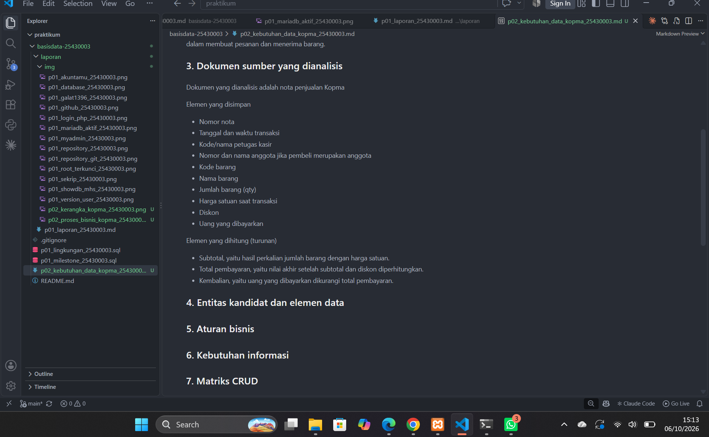

### D.4 – Entitas dan Aturan Bisnis

Entitas kandidat Kopma meliputi Anggota, Barang, Penjualan, Detail Penjualan, Petugas, Pemasok, serta Pembelian dan detailnya. Aturan bisnis digunakan untuk menjaga konsistensi data, misalnya setiap nota harus memiliki nomor unik dan minimal satu baris barang, stok tidak boleh negatif, serta harga jual pada nota harus tetap tersimpan meskipun harga barang berubah. Anggota juga harus berstatus aktif untuk memperoleh diskon 5%.

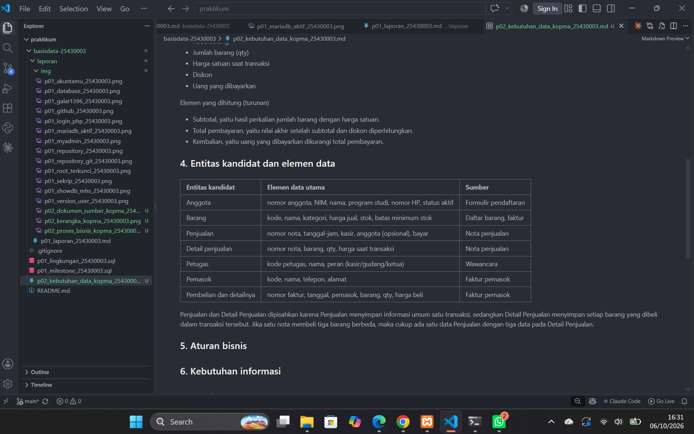 

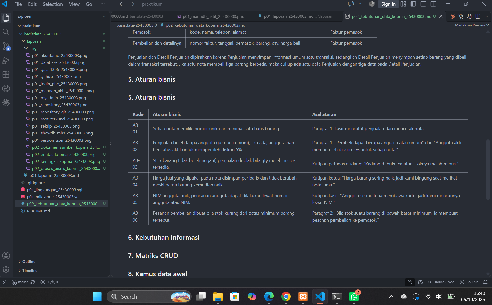

### D.5 – Kebutuhan Informasi dan Matriks CRUD

Kebutuhan informasi disusun berdasarkan informasi yang diperlukan petugas dan kepala perpustakaan. Contohnya adalah daftar anggota aktif, jumlah eksemplar yang tersedia, daftar peminjaman yang belum selesai, jumlah peminjaman per bulan, buku yang paling sering dipinjam, serta daftar keterlambatan dan denda. Matriks CRUD digunakan untuk menunjukkan proses yang membuat, membaca, memperbarui, atau menghapus data pada setiap entitas. Penyusunan matriks membantu memastikan hubungan antara proses bisnis dan data sudah sesuai.

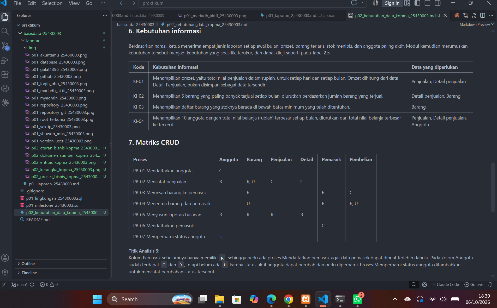

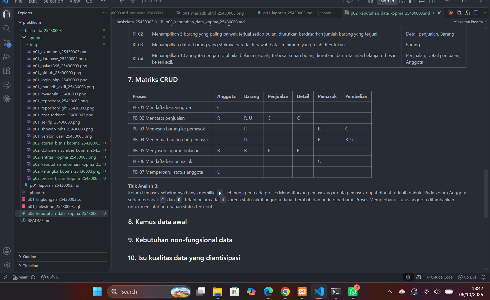

### D.6 – Kamus Data dan Non-Fungsional

Matriks CRUD disusun untuk menunjukkan proses bisnis yang membuat, membaca, memperbarui, atau menghapus data pada setiap entitas, dengan 6 entitas dan 7 proses bisnis. Kamus data berisi 11 elemen data, dengan kolom nama elemen, entitas, deskripsi, aturan atau format, serta penanggung jawab..

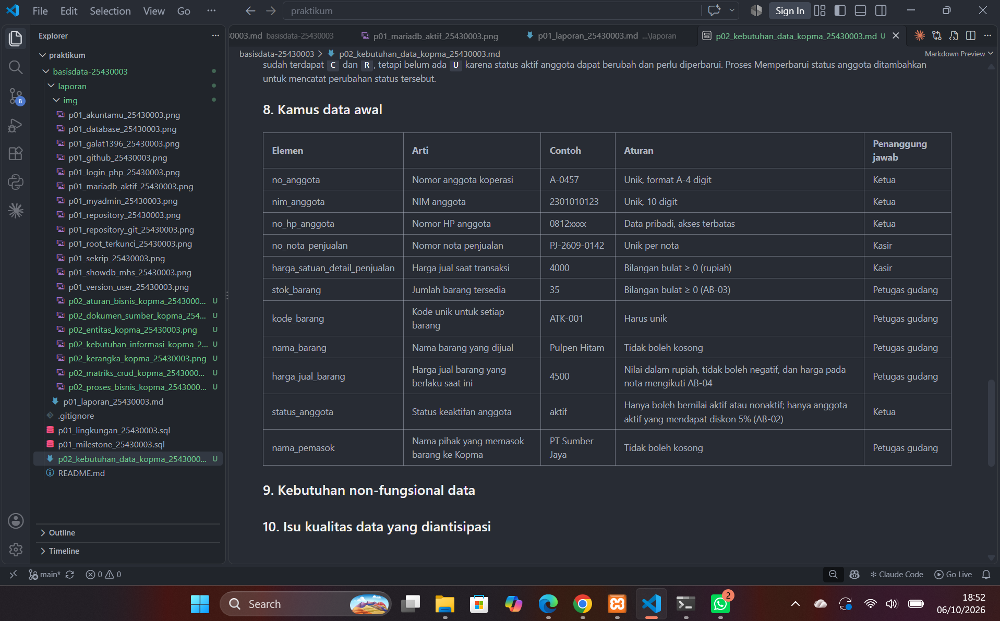

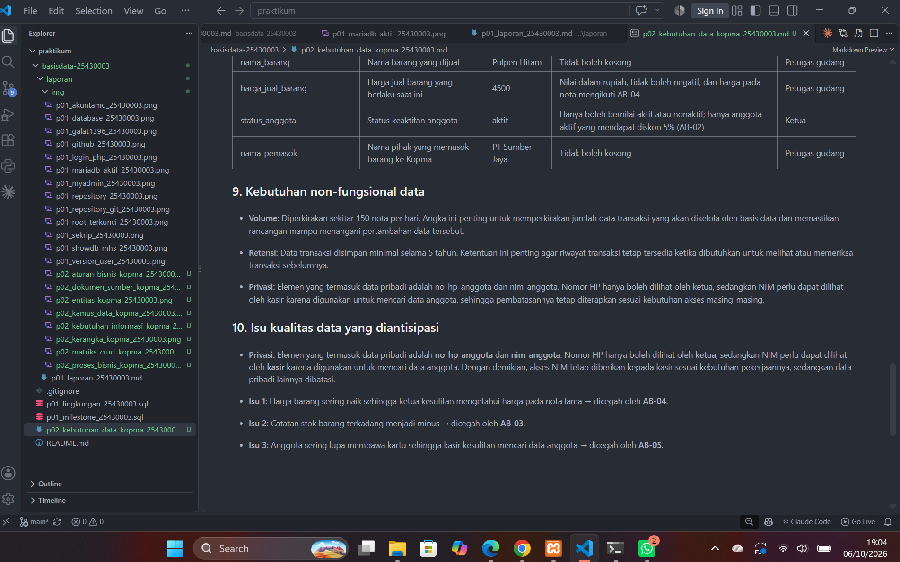

### D.7 – Dokumen dan Commit

Hasil analisis disimpan dalam berkas p02_kebutuhan_data_kopma_25430003.md. Setelah diperiksa, berkas ditambahkan ke Git, di-commit dengan pesan p02: dokumen kebutuhan data kopma, lalu di-push ke GitHub.

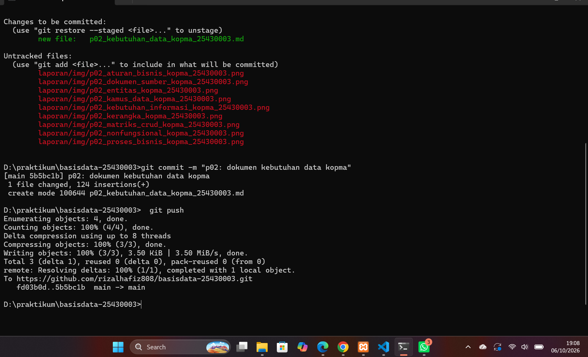

## 4. Jawaban Titik Analisis

### Titik Analisis 1

Jika harga pensil naik dari Rp3.000 menjadi Rp4.000, nota lama yang hanya menyimpan kode barang dapat menampilkan harga terbaru Rp4.000, padahal pembeli minggu lalu membayar Rp3.000. Hal ini sesuai dengan keluhan Ketua bahwa perubahan harga membuat nota lama membingungkan. Solusinya adalah menyimpan harga satuan saat transaksi pada setiap baris detail penjualan, sesuai aturan bisnis AB-04, agar riwayat harga tetap akurat meskipun harga barang berubah.

### Titik Analisis 2

Subtotal dan total sebaiknya tidak disimpan karena jika jumlah barang atau harga diperbaiki, nilainya bisa tidak ikut berubah sehingga hasil perhitungan menjadi salah. Namun, total bayar tetap disimpan di nota sebagai catatan resmi jumlah yang benar-benar harus dibayar, agar riwayat pembayaran tetap akurat meskipun aturan diskon berubah.

### Titik Analisis 3

Kolom Pemasok sebelumnya hanya memiliki `R`, sehingga perlu ada proses Mendaftarkan pemasok agar data pemasok dapat dibuat terlebih dahulu. Pada kolom Anggota sudah terdapat `C` dan `R`, tetapi belum ada `U` karena status aktif anggota dapat berubah dan perlu diperbarui. Proses Memperbarui status anggota ditambahkan untuk mencatat perubahan status tersebut.

### Perhitungan Parameter P

Dua digit terakhir NIM 25430003 adalah 03.

P = (2 digit terakhir NIM mod 9) + 1
P = (03 mod 9) + 1
P = 3 + 1 = **4**

| Ketentuan | Perhitungan | Hasil |
|---|---|---|
| Maksimal buku per transaksi | P + 2 = 4 + 2 | 6 eksemplar |
| Denda keterlambatan per eksemplar per hari | P × Rp1.000 | Rp4.000 |
| Perkiraan volume transaksi harian | 40 + (5 × VP) = 40 + (5 × 4) | 60 transaksi per hari |

Perhitungan lengkap dan penerapannya ada di bagian 9 berkas `p02_kebutuhan_data_25430003.md`.

## 5. Hasil Latihan dan Modifikasi

### Latihan E.1 - Poin Loyalitas

| Kode | Aturan bisnis |
|---|---|
| AB-07 | Poin dihitung dari total belanja setelah diskon anggota 5% dan sebelum potongan loyalitas, dengan setiap kelipatan penuh Rp10.000 mendapatkan 1 poin. Contoh: belanja Rp100.000 setelah diskon menjadi Rp95.000 sehingga memperoleh 9 poin. |
| AB-08 | Hanya anggota berstatus aktif yang memperoleh poin; transaksi anggota nonaktif tidak menghasilkan poin. Contoh: anggota nonaktif yang berbelanja Rp50.000 memperoleh 0 poin. |
| AB-09 | Setiap 50 poin dapat ditukar dengan potongan Rp5.000, dan penukaran hanya dapat dilakukan jika saldo poin anggota minimal 50 poin. Contoh: saldo 49 poin tidak dapat ditukar, sedangkan saldo 50 poin dapat ditukar menjadi potongan Rp5.000. |
| AB-10 | Setelah penukaran, saldo poin anggota tidak boleh negatif. Contoh: anggota dengan 80 poin yang menukar 50 poin harus memiliki sisa 30 poin. |
| AB-11 | Penukaran poin ditolak jika potongan melebihi total nota. Contoh: nota Rp3.000 dengan potongan Rp5.000 ditolak, poin anggota tetap 50 poin. |
| AB-12 | Hanya anggota aktif yang boleh menukar poin. Contoh: anggota nonaktif dengan 80 poin tidak boleh menukar 50 poin, saldo tetap 80 poin. |
| AB-13 | Potongan loyalitas dicatat pada nota. Contoh: nota Rp40.000 dengan potongan Rp5.000 menyimpan total belanja Rp40.000, potongan Rp5.000, dan total bayar Rp35.000. |

**Keputusan poin_diperoleh**

`poin_diperoleh` disimpan per transaksi karena poin yang diperoleh pada saat transaksi harus menjadi riwayat tetap, sehingga poin lama tidak berubah meskipun aturan perhitungan poin berubah di kemudian hari.

**Keputusan total bayar**

Total bayar disimpan di nota karena menjadi catatan resmi jumlah yang benar-benar harus dibayar saat transaksi, sehingga riwayat pembayaran tetap akurat meskipun aturan diskon berubah.

### Kebutuhan informasi baru

| Kode | Kebutuhan informasi | Data yang diperlukan |
|---|---|---|
| KI-05 | Kasir membutuhkan informasi saldo poin loyalitas anggota saat transaksi berlangsung agar dapat mengetahui jumlah poin yang tersedia untuk ditukar. | Anggota, Penjualan, `poin_diperoleh`, Penukaran Poin, `poin_digunakan` |
| KI-06 | Ketua membutuhkan laporan jumlah poin yang diperoleh, ditukar, dan saldo poin anggota setiap bulan untuk memantau penggunaan program loyalitas. | Anggota, Penjualan, Penukaran Poin, `poin_diperoleh`, `poin_digunakan` ||

**Cara pengujian KI-05:**

Jika anggota memiliki total perolehan 100 poin dan sudah menukar 50 poin, sistem harus menampilkan saldo **50 poin** saat kasir mencari anggota tersebut.

**Cara pengujian KI-06:**

Pada laporan bulan Oktober, Anggota A memperoleh 100 poin dan menukar 50 poin, sedangkan Anggota B memperoleh 80 poin dan belum menukar poin. Laporan harus menampilkan total perolehan **180 poin**, total penukaran **50 poin**, dan saldo gabungan **130 poin**.

**Keputusan saldo poin**

Saldo poin dihitung, bukan disimpan sebagai nilai terpisah, karena saldo dapat diperoleh dari total `poin_diperoleh` dikurangi total `poin_digunakan`, sehingga tidak terjadi perbedaan antara saldo dan riwayat transaksi.

### Matriks CRUD baru

| Proses | Anggota | Penjualan | Penukaran Poin | Detail penjualan | Barang |
|---|---|---|---|---|---|
| PB-02 Mencatat penjualan | R | C | — | C | R, U |
| PB-08 Menukar poin loyalitas | R | R, U | C | — | — |

Penjualan diberi `R, U` pada PB-08 karena sistem perlu membaca total nota untuk memeriksa batas potongan dan memperbarui nota dengan mencatat potongan loyalitas. Pada PB-02, `poin_diperoleh` disimpan pada entitas Penjualan yang sudah ada, sehingga huruf `C` tetap dan tidak perlu menambahkan entitas baru.

### Latihan E.2 - Kebutuhan Non-Fungsional yang Terukur

**a. Keamanan data anggota**

Data nomor HP anggota hanya boleh dilihat oleh ketua koperasi, sedangkan kasir tidak boleh melihatnya. Cara uji: masuk sebagai kasir dan buka data anggota; nomor HP harus tidak ditampilkan, kemudian masuk sebagai ketua dan pastikan nomor HP dapat dilihat.

**b. Kecepatan pencarian barang**

Sistem harus menampilkan barang berdasarkan kode atau nama barang dalam waktu maksimal 2 detik untuk katalog hingga 10.000 barang. Cara uji: lakukan 20 kali pencarian dengan kata kunci berbeda dan pastikan setiap pencarian selesai maksimal 2 detik.

**c. Akurasi laporan stok**

Stok yang benar dihitung dari stok awal ditambah jumlah barang yang diterima dari pemasok, kemudian dikurangi jumlah barang yang terjual. Cara uji: jika stok awal 20 barang, penerimaan 15 barang, dan penjualan 8 barang, laporan stok harus menampilkan 27 barang.

## 6. Tugas Mandiri: Milestone Proyek

Milestone 2 yang saya buat adalah dokumen kebutuhan data dengan tema Perpustakaan Cendekia RH. Dokumen tersebut disimpan dalam berkas p02_kebutuhan_data_25430003.md.

Berdasarkan perhitungan langsung dari berkas, terdapat 6 proses bisnis (PB), 8 entitas, 14 aturan bisnis (AB), 7 kebutuhan informasi (KI), dan 39 elemen kamus data. Hasil perhitungan parameter berdasarkan NIM adalah P = (03 mod 9) + 1 = 4, sehingga batas peminjaman maksimal 6 eksemplar per transaksi, denda Rp4.000 per eksemplar per hari, dan perkiraan volume transaksi sebanyak 60 transaksi per hari.

 Tautan GitHub berkas: [https://github.com/rizalhafiz808/basisdata-25430003/blob/main/p02_kebutuhan_data_25430003.md]. 
 
 Keterbatasan yang saya sadari adalah beberapa elemen pada kamus data belum sepenuhnya konsisten dengan entitas kandidat, tetapi pada milestone ini saya memilih tidak merevisi isi dokumen tersebut.

 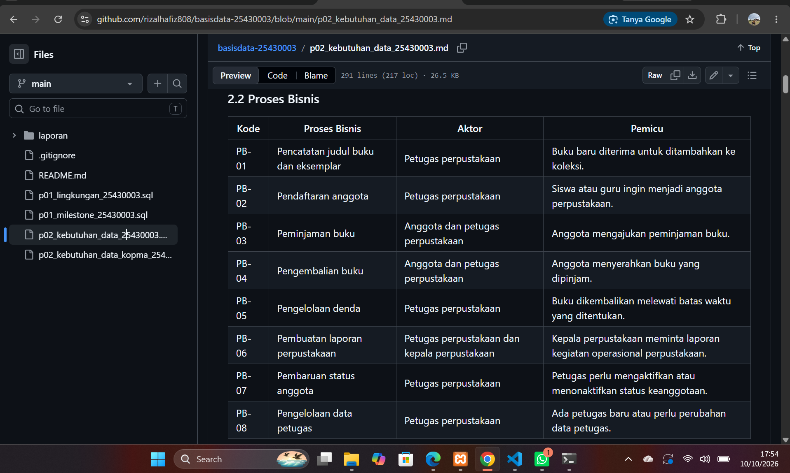
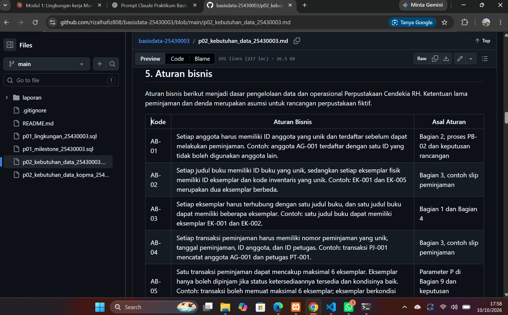
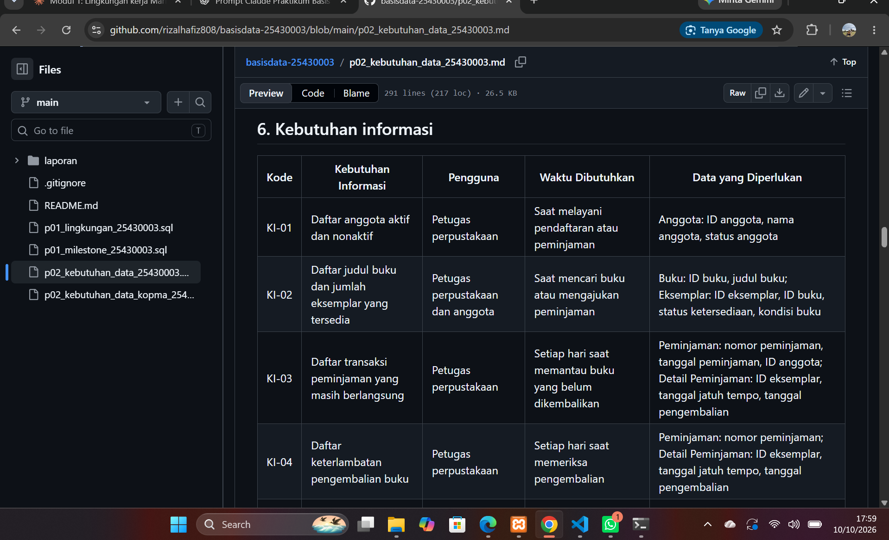
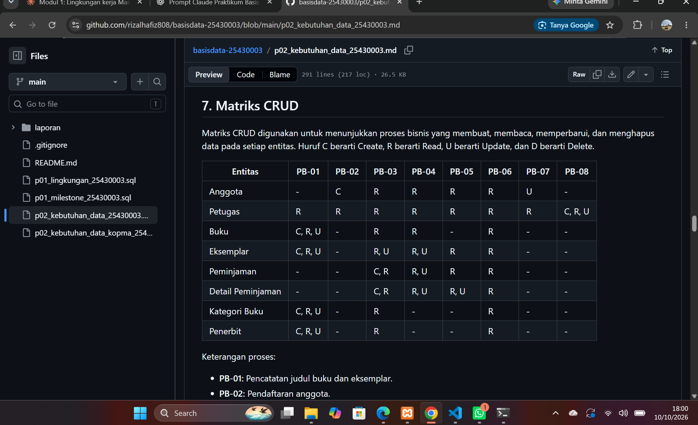
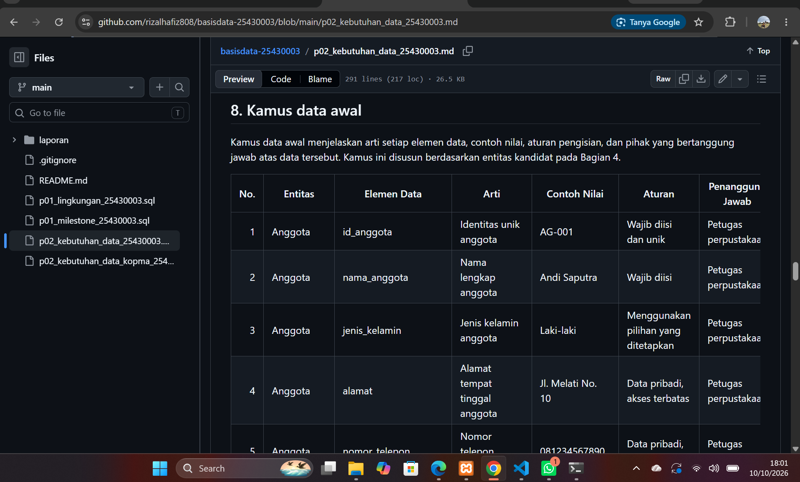

## 7. Pembahasan dan Kendala

## 7.1 Pembahasan

Dalam merancang basis data Perpustakaan Cendekia RH, saya memutuskan memisahkan entitas Buku dan Eksemplar agar satu judul buku dapat memiliki beberapa salinan fisik dengan status berbeda. Entitas Peminjaman dan Detail Peminjaman juga dipisahkan karena satu transaksi dapat mencakup lebih dari satu eksemplar. Selain itu, denda dihitung berdasarkan selisih tanggal jatuh tempo dan tanggal pengembalian agar jumlah keterlambatan dapat ditentukan dengan jelas. Contohnya, jika satu nota peminjaman seperti PJ-001 memuat dua eksemplar, setiap eksemplar perlu dicatat pada Detail Peminjaman agar data peminjaman dapat dilacak secara terpisah.

## 7.2 Kendala dan Cara Mengatasinya

- Saya sempat keliru menghitung jumlah proses bisnis (PB), aturan bisnis (AB), dan elemen kamus data. Saya mengatasinya dengan menghitung ulang kode dan baris elemen secara langsung dari tabel di berkas.
- Saya menemukan elemen `tanggal_perolehan` pada tabel entitas kandidat, tetapi elemen tersebut belum tercantum dalam kamus data. Saya mencatatnya sebagai ketidakkonsistenan dalam dokumen.
- Saya menyadari masih ada bagian Milestone yang belum konsisten. Saya memutuskan untuk tidak merevisi isi Milestone pada tahap ini dan mencatat ketidakkonsistenan tersebut sebagai keterbatasan dokumen.

## 8. Kesimpulan

Pada Modul 2, saya mengerjakan dokumen analisis data Kopma, Latihan E.1 dan E.2, serta Milestone kebutuhan data Perpustakaan Cendekia RH. Dari pengerjaan tersebut, saya memahami bahwa `total_bayar` dapat dihitung dari data transaksi, sedangkan harga saat transaksi perlu disimpan pada setiap baris nota agar riwayat harga tetap tercatat. Pada proyek perpustakaan, saya juga memisahkan data buku dan eksemplar agar setiap salinan fisik dapat dikelola secara terpisah. Namun, saya menyadari bahwa Milestone Perpustakaan masih memiliki beberapa ketidakkonsistenan dan saya memilih tidak merevisinya pada tahap ini.

## 9. Pernyataan Penggunaan AI

Dalam mengerjakan Modul 2, saya menggunakan Claude untuk membantu mengerjakan tugas proyek serta ChatGPT untuk membantu menganalisis materi, menyusun pembahasan, dan membuat laporan. AI membantu saya memahami kebutuhan data, menyusun struktur dokumen, serta merapikan penulisan laporan. Saya tetap perlu memeriksa kembali hasil yang diberikan AI agar sesuai dengan isi tugas dan pekerjaan yang saya lakukan. Saya menyadari bahwa hasil bantuan AI tidak selalu sempurna sehingga ketepatan data dan konsistensi dokumen tetap perlu saya perhatikan.

## 10. Bukti Git

| Hash | Pesan commit | Berkas |
|---|---|---|
| 5b5bc1b | p02: dokumen kebutuhan data kopma | p02_kebutuhan_data_kopma_25430003.md |
| 08a69ae | p02: dokumen kebutuhan data perpustakaan | p02_kebutuhan_data_25430003.md |

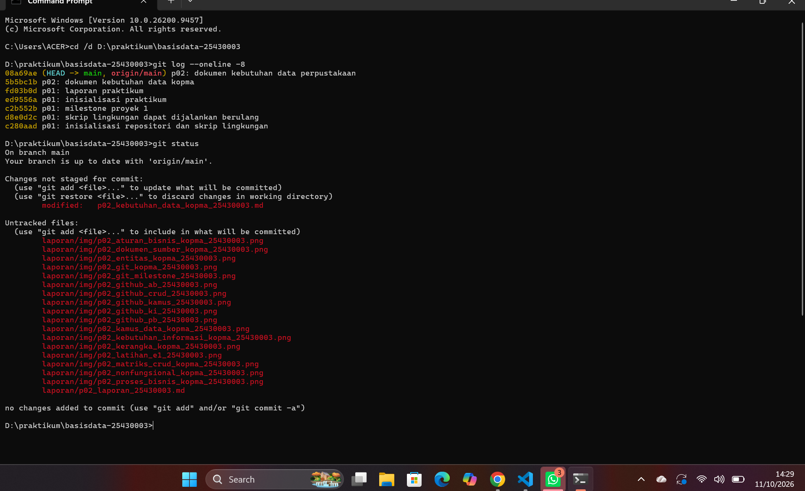

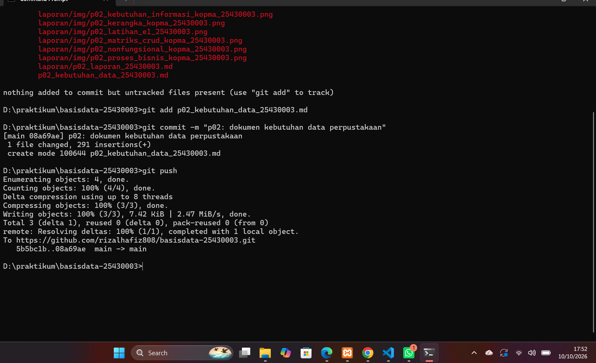

## 11. Checklist

# Checklist Umum (Berlaku di Semua Pertemuan)

| ✓ | **Butir** | **Yang harus ada** |
|---|---|---|
| ☑ | **Identitas** | Nama, NIM, kelas, pertemuan ke-N, tanggal pelaksanaan, nama asisten/dosen |
| ☑ | **Tujuan** | Tujuan praktikum ditulis ulang dengan bahasa sendiri (maksimal 5 baris) |
| ☑ | **Ringkasan teori** | Pemahaman sendiri atas Dasar Teori, maksimal setengah halaman, tanpa menyalin |
| ☑ | **Langkah percobaan (D)** | Tangkapan layar hasil langkah kunci sesuai checklist khusus, masing-masing diberi keterangan singkat |
| ☑ | **Titik Analisis** | Semua Titik Analisis dijawab lengkap dengan alasan, bukan sekadar ya/tidak |
| ☑ | **Latihan (E)** | Skrip/dokumen hasil latihan beserta bukti berjalan |
| ☑ | **Tugas Mandiri (F)** | Milestone proyek pertemuan ini: berkas, bukti, dan penjelasan keputusan desain |
| ☑ | **Pembahasan dan kendala** | Galat yang ditemui, cara membacanya, dan cara mengatasinya |
| ☑ | **Kesimpulan** | Dua sampai empat kalimat dengan bahasa sendiri |
| ☑ | **Pernyataan Penggunaan AI** | Alat yang dipakai, untuk apa, bagian mana; tulis “tidak menggunakan” bila tidak memakai |
| ☑ | **Bukti Git** | Tautan repositori dan kode commit (hash) pertemuan ini dengan pesan `pNN: ...` |
| ☑ | **Keaslian** | Setiap tangkapan layar memperlihatkan akun ber-NIM dan jam sistem; nama objek memuat NIM/inisial |

## Checklist Khusus Modul 2 — Analisis Kebutuhan Pengelolaan Data

| Status | Jenis | Yang Harus Ada |
|---|---|---|
| [☑] | Berkas wajib | `p02_kebutuhan_data_kopma_25430003.md` dan `p02_kebutuhan_data_25430003.md` (proyek) |
| [☑] | Bukti tangkapan layar | Tabel PB, AB, KI, matriks CRUD, dan kamus data di berkas proyek (tangkapan tampilan GitHub) |
| [☑] | Analisis wajib | Titik Analisis 1–3; perhitungan parameter P; perbaikan tiga pernyataan kebutuhan kabur |