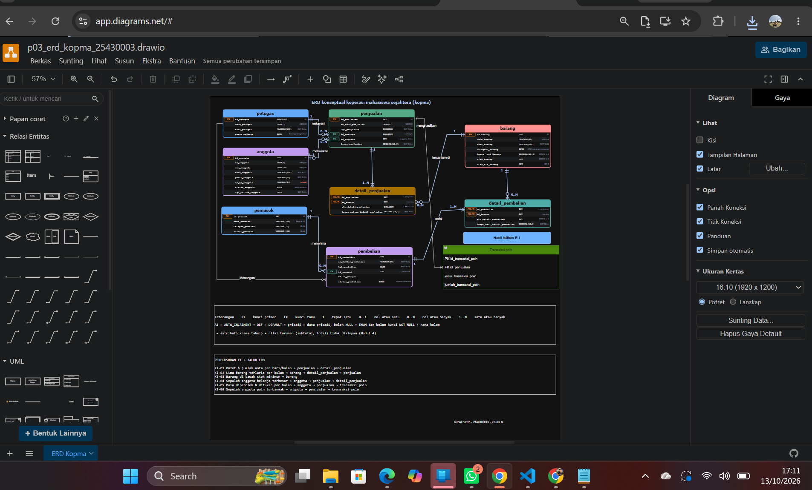
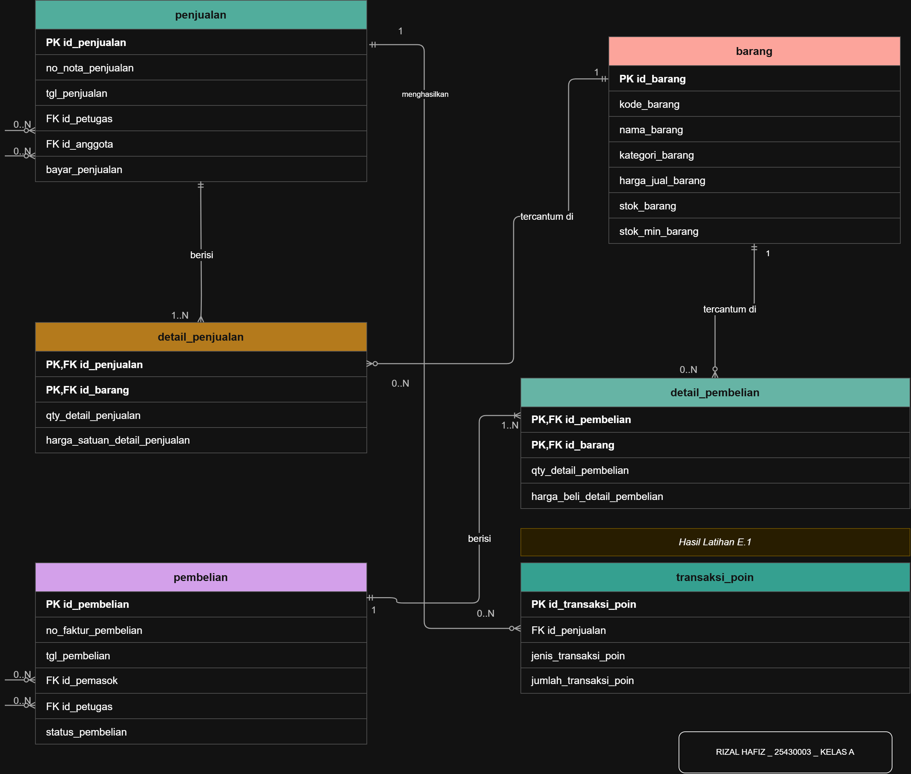
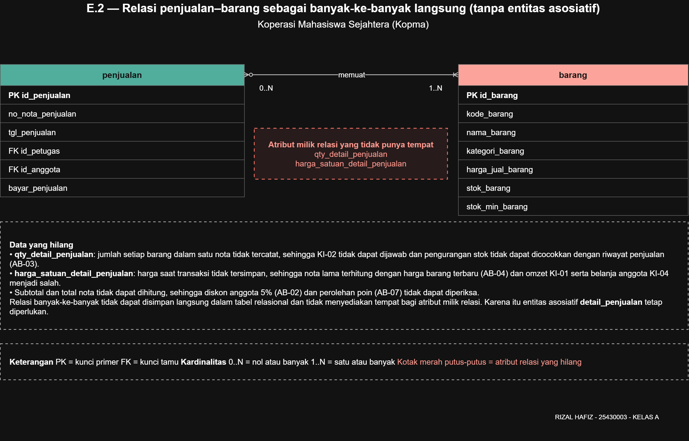
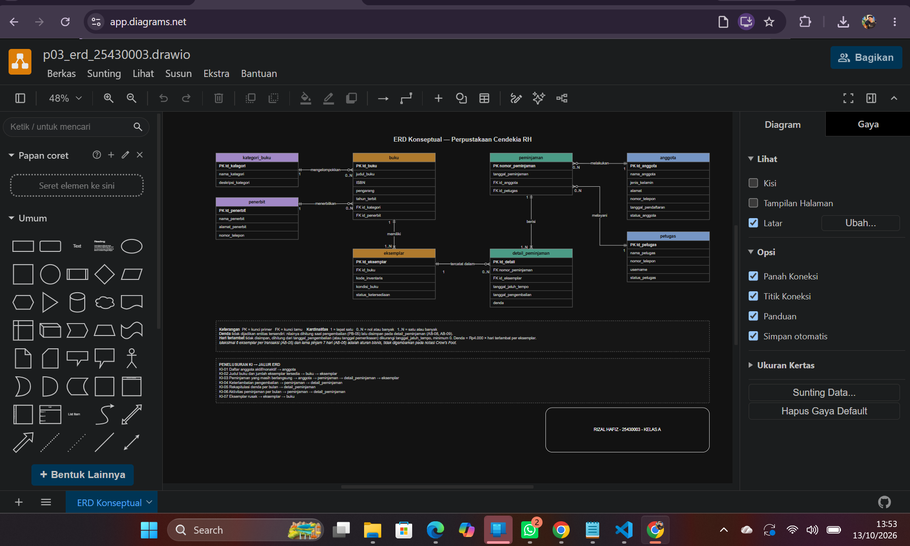
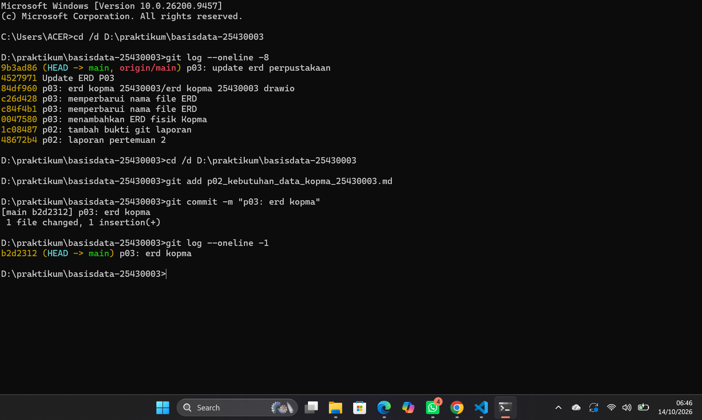
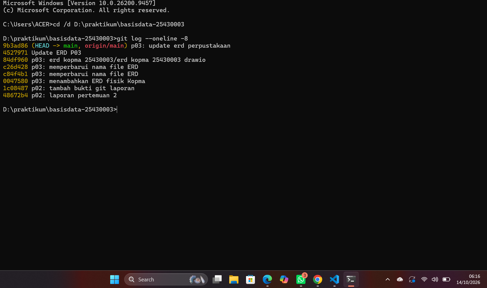

# Laporan Praktikum Basis Data - Pertemuan 03

**Nama:** Rizal Hafiz

**NIM:** 25430003

**Kelas:** A

**Pertemuan:** 3

**Dosen/Asisten:** [Dosen: Dedi Irawan,S.Kom., M.T.I]

## 1. Tujuan Praktikum

- Membuat ERD berdasarkan kebutuhan data dan aturan bisnis yang telah disusun pada pertemuan sebelumnya.
- Menentukan relasi, kardinalitas, dan partisipasi antarentitas berdasarkan aturan bisnis.
- Mengenali entitas asosiatif untuk menghubungkan entitas yang memiliki relasi banyak-ke-banyak.

## 2. Ringkasan Dasar Teori

Entity Relationship Diagram (ERD) merupakan diagram yang menggambarkan entitas, atribut, dan hubungan antarentitas dalam suatu sistem basis data. Kunci primer (*Primary Key*) digunakan sebagai identitas unik, kunci alternatif (*Alternate Key*) sebagai identitas unik selain kunci primer, sedangkan kunci tamu (*Foreign Key*) digunakan untuk menghubungkan tabel. Kardinalitas dan partisipasi menjelaskan jumlah keterlibatan entitas dalam suatu relasi menggunakan notasi Crow’s Foot. Relasi banyak-ke-banyak perlu dipecah menggunakan entitas asosiatif karena hubungan langsung tidak menyediakan tempat yang tepat untuk menyimpan atribut milik pasangan entitas, seperti jumlah barang dan harga satuan saat transaksi. Atribut turunan, seperti subtotal, total pembayaran, dan kembalian, merupakan nilai yang diperoleh melalui perhitungan dari atribut lain sehingga tidak harus disimpan sebagai data tersendiri.

## 3. hasil langkah percobaan

### D.1 — Entitas, Kunci, dan Atribut Turunan

Berdasarkan analisis kebutuhan data Kopma, terdapat delapan entitas awal setelah Pembelian dan Detail Pembelian dipisahkan. Setiap entitas memiliki kunci primer untuk membedakan datanya secara unik.

| Entitas | Kunci primer |
|---|---|
| anggota | `id_anggota` |
| barang | `id_barang` |
| penjualan | `id_penjualan` |
| detail_penjualan | `id_penjualan` + `id_barang` |
| petugas | `id_petugas` |
| pemasok | `id_pemasok` |
| pembelian | `id_pembelian` |
| detail_pembelian | `id_pembelian` + `id_barang` |

Kunci alternatif yang digunakan adalah NIM pada entitas `anggota` dan nomor nota pada entitas `penjualan`, karena keduanya bersifat unik. Atribut turunan meliputi subtotal, total pembayaran, dan kembalian. Subtotal dihitung dari kuantitas dikalikan harga satuan, total pembayaran dihitung setelah diskon diperhitungkan, sedangkan kembalian diperoleh dari uang yang dibayarkan dikurangi total pembayaran.

### D.2 — Tabel Relasi Kopma

| Entitas kiri | Relasi | Entitas kanan | Sisi kiri | Sisi kanan | Dasar |
|---|---|---|---|---|---|
| petugas | melayani | penjualan | Tepat satu | Nol atau banyak | Wawancara |
| anggota | melakukan | penjualan | Nol atau satu | Nol atau banyak | AB-02 |
| penjualan | berisi | detail_penjualan | Tepat satu | Satu atau banyak | AB-01 |
| barang | tercantum di | detail_penjualan | Tepat satu | Nol atau banyak | AB-04* |
| pemasok | menerima | pembelian | Tepat satu | Nol atau banyak | Faktur pemasok |
| pembelian | berisi | detail_pembelian | Tepat satu | Satu atau banyak | Faktur pemasok |
| barang | tercantum di | detail_pembelian | Tepat satu | Nol atau banyak | Faktur pemasok |
| petugas | menangani | pembelian | Tepat satu | Nol atau banyak | PB-03, PB-04 |
| penjualan | menghasilkan | transaksi_poin | Tepat satu | Nol atau satu | Latihan E.1 — aturan poin loyalitas |

**Catatan analisis relasi:**

- **Barang–detail_penjualan:** AB-04 mengatur bahwa harga jual saat transaksi disimpan pada setiap baris detail, bukan kardinalitas secara langsung. Kardinalitas didasarkan pada struktur nota: setiap baris detail mengacu pada satu barang, sedangkan satu barang dapat muncul pada banyak transaksi.
- **Barang–detail_pembelian:** faktur pemasok menjadi sumber pencatatan barang, kuantitas, dan harga beli pada setiap baris pembelian.
- **Petugas–pembelian:** PB-03 dan PB-04 menetapkan bahwa petugas gudang memesan dan menerima barang dari pemasok. Satu pembelian diasumsikan ditangani oleh satu petugas.
- **Penjualan–transaksi_poin:** satu penjualan dapat tidak menghasilkan catatan poin atau menghasilkan satu catatan poin, sesuai aturan perolehan poin dalam Latihan E.1.

### D.3 — ERD Kopma

ERD Kopma terdiri dari sembilan tabel, yaitu `anggota`, `barang`, `penjualan`, `detail_penjualan`, `petugas`, `pemasok`, `pembelian`, `detail_pembelian`, dan `transaksi_poin`. Entitas asosiatif yang digunakan adalah `detail_penjualan` dan `detail_pembelian` karena keduanya menghubungkan transaksi dengan barang yang dicatat pada setiap baris. Pada Latihan E.1, tabel `transaksi_poin` ditambahkan untuk mencatat riwayat perolehan dan penukaran poin loyalitas sehingga perubahan poin dapat ditelusuri.

### D.4 Memvalidasi ERD terhadap Kebutuhan Informasi

Saya menelusuri jalur hubungan pada ERD untuk memastikan setiap kebutuhan informasi dapat dijawab oleh entitas yang tersedia. Pemeriksaan awal menunjukkan bahwa KI-05 dan KI-06 belum dapat ditelusuri karena ERD belum memiliki entitas riwayat poin. Setelah mengerjakan Latihan E.1, saya menambahkan `transaksi_poin` beserta relasinya, lalu memperbarui jalur kedua kebutuhan informasi tersebut.

| Kode | Kebutuhan informasi | Jalur di ERD |
|---|---|---|
| KI-01 | Omzet dan jumlah nota per hari dan per bulan | `penjualan → detail_penjualan` |
| KI-02 | Lima barang terlaris per bulan berdasarkan qty | `barang → detail_penjualan → penjualan` |
| KI-03 | Barang dengan stok di bawah batas minimum | `barang` |
| KI-04 | Sepuluh anggota dengan belanja terbesar per bulan | `anggota → penjualan → detail_penjualan` |
| KI-05 | Jumlah poin yang diperoleh dan ditukar anggota per bulan | `anggota → penjualan → transaksi_poin` |
| KI-06 | Sepuluh anggota dengan perolehan poin terbanyak per bulan | `anggota → penjualan → transaksi_poin` |

## 4. Jawaban Titik Analisis

### Titik analisis 1 

id_anggota tetap digunakan sebagai kunci primer karena lebih stabil dan tidak bergantung pada identitas akademik anggota. NIM dapat dijadikan kunci alternatif karena bersifat unik, tetapi jika NIM menjadi kunci primer, perubahan NIM dapat menyebabkan perubahan pada tabel lain yang menggunakan NIM sebagai referensi.

### Titik analisis 2

Aturan bisnis AB-01 menyatakan bahwa setiap nota harus memiliki nomor unik dan minimal satu baris barang. Karena itu, setiap penjualan wajib memiliki satu atau lebih detail_penjualan.
Aturan minimal satu baris barang tidak bisa dijamin oleh struktur tabel saja, karena data penjualan dapat disimpan terlebih dahulu sebelum detail barang dimasukkan. Diperlukan validasi tambahan, misalnya transaksi database atau trigger, agar nota tidak tersimpan tanpa detail barang.

### Titik analisis 3

**Aturan bisnis baru (AB-08):** Setiap transaksi pembelian yang melibatkan penerimaan barang dari pemasok harus dikaitkan dengan tepat satu petugas gudang yang bertanggung jawab menerima barang tersebut, sedangkan satu petugas gudang dapat menangani nol atau banyak transaksi pembelian.

## 5. Hasil Latihan dan Modifikasi

### E.1 — Poin loyalitas

Menurut saya, poin loyalitas lebih tepat menggunakan entitas transaksi_poin daripada hanya menjadi atribut pada entitas anggota. Satu angka saldo poin tidak dapat menunjukkan jumlah poin yang diperoleh dan ditukar setiap bulan karena riwayat perubahan poin tidak tercatat. Oleh karena itu, entitas transaksi_poin digunakan untuk mencatat jenis transaksi dan jumlah poin yang diperoleh atau ditukar. Saya menambahkan relasi penjualan → transaksi_poin agar transaksi poin dapat dihubungkan dengan penjualan yang terkait.

### E.2 — Relasi penjualan–barang banyak-ke-banyak langsung
**Data yang hilang**

- `qty_detail_penjualan`: jumlah setiap barang dalam satu nota tidak tercatat, sehingga KI-02 tidak dapat dijawab dan pengurangan stok tidak dapat dicocokkan dengan riwayat penjualan (AB-03).
- `harga_satuan_detail_penjualan`: harga saat transaksi tidak tersimpan, sehingga nota lama terhitung dengan harga barang terbaru (AB-04) dan omzet KI-01 serta belanja anggota KI-04 menjadi salah.
- Subtotal dan total nota tidak dapat dihitung, sehingga diskon anggota 5% (AB-02) dan perolehan poin (AB-07) tidak dapat diperiksa.

Relasi banyak-ke-banyak tidak dapat disimpan langsung dalam tabel relasional dan tidak menyediakan tempat bagi atribut milik relasi. Karena itu entitas asosiatif `detail_penjualan` tetap diperlukan.

## 6. Tugas Mandiri: Milestone Proyek 3

### 6.1 ERD proyek

ERD proyek perpustakaan terdiri dari delapan entitas, yaitu `anggota`, `petugas`, `kategori_buku`, `penerbit`, `buku`, `eksemplar`, `peminjaman`, dan `detail_peminjaman`. Diagram ini menggambarkan hubungan antarentitas untuk mendukung pengelolaan data anggota, koleksi buku, transaksi peminjaman, serta pengembalian buku dan denda.

### 6.2 Tabel relasi dan kardinalitas

| Entitas kiri | Relasi | Entitas kanan | Sisi kiri | Sisi kanan | Dasar |
|---|---|---|---|---|---|
| anggota | melakukan | peminjaman | Tepat satu | Nol atau banyak | AB-01, AB-04, AB-11 |
| petugas | melayani | peminjaman | Tepat satu | Nol atau banyak | AB-04 |
| kategori_buku | mengelompokkan | buku | Tepat satu | Nol atau banyak | AB-10 |
| penerbit | menerbitkan | buku | Tepat satu | Nol atau banyak | AB-10 |
| buku | memiliki | eksemplar | Tepat satu | Nol atau banyak | AB-03 |
| peminjaman | berisi | detail_peminjaman | Tepat satu | Satu atau banyak | AB-04, AB-05, AB-06 |
| eksemplar | tercatat dalam | detail_peminjaman | Tepat satu | Nol atau banyak | AB-05, AB-07 |

### 6.3 Penelusuran KI → jalur ERD

| KI | Kebutuhan informasi | Jalur di ERD |
|---|---|---|
| KI-01 | Daftar anggota aktif dan nonaktif | `anggota` |
| KI-02 | Daftar judul buku dan jumlah eksemplar yang tersedia | `buku → eksemplar` |
| KI-03 | Daftar transaksi peminjaman yang masih berlangsung | `anggota → peminjaman → detail_peminjaman → eksemplar` |
| KI-04 | Daftar keterlambatan pengembalian buku | `peminjaman → detail_peminjaman` |
| KI-05 | Rekapitulasi denda keterlambatan | `detail_peminjaman` |
| KI-06 | Laporan aktivitas peminjaman | `peminjaman → detail_peminjaman` |
| KI-07 | Daftar eksemplar yang rusak | `eksemplar → buku` |

### 6.4 Entitas asosiatif

Entitas asosiatif pada ERD proyek perpustakaan adalah `detail_peminjaman`, yang menghubungkan entitas `peminjaman` dan `eksemplar`. Entitas ini memiliki atribut sendiri, yaitu `tanggal_jatuh_tempo`, `tanggal_pengembalian`, dan `denda`, untuk mencatat informasi setiap eksemplar dalam transaksi peminjaman. Entitas ini diperlukan agar satu transaksi dapat mencakup beberapa eksemplar dan setiap eksemplar memiliki informasi pengembalian serta denda masing-masing.

### 6.5 Catatan Tinjauan Klien

**Peninjau:** Mutiara Icha Yani — 25430025  
**Peran:** Ketua Perpustakaan  
**Tanggal:** 13 Oktober 2026

1. **Umpan balik:** Garis relasi antara `buku` dan `eksemplar` sudah menunjukkan hubungan satu-ke-banyak. Namun, perlu dipastikan bahwa setiap eksemplar selalu terhubung dengan satu judul buku agar data koleksi tidak berdiri sendiri.  
   **Keputusan:** Diterima.  
   **Alasan:** Masukan ini sesuai dengan aturan bisnis AB-03, sehingga hubungan antara judul buku dan setiap eksemplar perlu dipastikan tetap konsisten.

2. **Umpan balik:** Pada entitas `detail_peminjaman`, sudah terdapat atribut `tanggal_jatuh_tempo`, `tanggal_pengembalian`, dan `denda`. Sebaiknya dijelaskan bahwa tanggal pengembalian dapat kosong selama buku masih dipinjam, sehingga status keterlambatan dapat dihitung dengan benar.  
   **Keputusan:** Diterima.  
   **Alasan:** Masukan ini membantu memperjelas pencatatan pengembalian dan perhitungan keterlambatan tanpa mengubah struktur utama ERD.

## 7. Pembahasan dan Kendala

### 7.1 Pembahasan

Melalui praktikum Modul 3, saya mempelajari cara menggambarkan hubungan antarentitas menggunakan ERD konseptual dan menentukan kardinalitas berdasarkan aturan bisnis. Saya juga memahami bahwa relasi satu-ke-banyak perlu dibaca dari kedua sisi agar jumlah hubungan setiap entitas tidak terbalik. Relasi banyak-ke-banyak antara peminjaman dan eksemplar dipecah menggunakan entitas asosiatif `detail_peminjaman` agar setiap eksemplar yang dipinjam dapat dicatat beserta tanggal jatuh tempo, tanggal pengembalian, dan dendanya. Selain itu, penelusuran kebutuhan informasi ke jalur ERD membantu memastikan bahwa data yang diperlukan untuk laporan perpustakaan dapat diperoleh dari entitas yang tersedia.

### 7.2 Kendala dan solusi

1. **Kendala:** Pada tabel relasi dan kardinalitas awal, penempatan sisi kiri dan sisi kanan sempat terbalik sehingga hubungan antarentitas berisiko dibaca secara keliru.  
   **Solusi:** Saya memeriksa kembali kardinalitas dari kedua arah dengan menentukan jumlah minimum dan maksimum setiap entitas, kemudian menyesuaikan tabel dengan relasi pada ERD.

2. **Kendala:** Relasi `buku` dan `eksemplar` sempat menggunakan kardinalitas satu atau banyak pada sisi eksemplar, padahal aturan bisnis AB-03 hanya menyatakan bahwa satu buku dapat memiliki beberapa eksemplar.  
   **Solusi:** Saya meninjau kembali aturan bisnis dan menyesuaikan kardinalitas agar jumlah minimum eksemplar tidak diwajibkan tanpa dasar aturan yang jelas.

3. **Kendala:** ERD Kopma pada awalnya belum dapat menunjukkan petugas gudang yang menerima barang dari pemasok karena belum terdapat relasi antara `petugas` dan `pembelian`.  
   **Solusi:** Saya menambahkan relasi petugas dengan pembelian, mencantumkan `id_petugas` sebagai kunci tamu pada entitas pembelian, serta merencanakan aturan bisnis baru dengan nomor setelah aturan bisnis terakhir yang sudah digunakan.

## 8. Kesimpulan

1. Saya berhasil menyusun ERD konseptual Perpustakaan Cendekia RH yang menggambarkan entitas, atribut, relasi, dan kardinalitas berdasarkan kebutuhan data.
2. Saya mempelajari cara menentukan kardinalitas berdasarkan aturan bisnis, menggunakan entitas asosiatif, dan menelusuri jalur ERD untuk menjawab kebutuhan informasi.
3. Pada Pertemuan 4, saya akan menggunakan ERD ini sebagai dasar untuk memeriksa normalisasi dan memperbaiki rancangan jika ditemukan masalah.

## 9. Pernyataan Penggunaan AI

Dalam pengerjaan Modul 3, saya menggunakan bantuan AI untuk mendukung proses penyusunan proyek dan laporan praktikum. Penggunaan AI saya jelaskan sebagai berikut.

1. **Alat yang digunakan:** Saya menggunakan Claude dan ChatGPT sebagai alat bantu selama pengerjaan proyek.

2. **Tujuan penggunaan:** Claude saya gunakan untuk membantu mengerjakan dan mengembangkan proyek perpustakaan, sedangkan ChatGPT saya gunakan untuk membantu memahami materi ERD, menyusun laporan praktikum, serta membuat rancangan awal ERD Kopma dan Perpustakaan.

3. **Bagian yang terbantu dan dikerjakan sendiri:** AI membantu saya menyusun rancangan awal ERD, memahami hubungan ant entitas, serta menyusun penjelasan laporan. Saya kemudian memeriksa dan mengedit kembali rancangan tersebut, termasuk menyesuaikan warna, label relasi, dan atribut kunci tamu seperti `id_petugas` sesuai kebutuhan. Saya juga menyesuaikan isi laporan dan tinjauan klien dengan hasil pengerjaan serta masukan yang diperoleh.

## 10. Bukti Git

Repositori: https://github.com/rizalhafiz808/basisdata-25430003

| Hash | Pesan commit |
|---|---|
| 0047580 | p03: menambahkan ERD fisik Kopma |
| c84f4b1 | p03: memperbarui nama file ERD |
| c26d428 | p03: memperbarui nama file ERD |
| 84df960 | p03: erd kopma 25430003/erd kopma 25430003 drawio |
| 4527971 | Update ERD P03 |
| 9b3ad86 | p03: update erd perpustakaan |
| b2d2312 | p03: erd kopma |

## 11. Checklist

# Checklist Umum (Berlaku di Semua Pertemuan)

| ✓ | **Butir** | **Yang harus ada** |
|---|---|---|
| ☑ | **Identitas** | Nama, NIM, kelas, pertemuan ke-N, tanggal pelaksanaan, nama asisten/dosen |
| ☑ | **Tujuan** | Tujuan praktikum ditulis ulang dengan bahasa sendiri (maksimal 5 baris) |
| ☑ | **Ringkasan teori** | Pemahaman sendiri atas Dasar Teori, maksimal setengah halaman, tanpa menyalin |
| ☑ | **Langkah percobaan (D)** | Tangkapan layar hasil langkah kunci sesuai checklist khusus, masing-masing diberi keterangan singkat |
| ☑ | **Titik Analisis** | Semua Titik Analisis dijawab lengkap dengan alasan, bukan sekadar ya/tidak |
| ☑ | **Latihan (E)** | Skrip/dokumen hasil latihan beserta bukti berjalan |
| ☑ | **Tugas Mandiri (F)** | Milestone proyek pertemuan ini: berkas, bukti, dan penjelasan keputusan desain |
| ☑ | **Pembahasan dan kendala** | Galat yang ditemui, cara membacanya, dan cara mengatasinya |
| ☑ | **Kesimpulan** | Dua sampai empat kalimat dengan bahasa sendiri |
| ☑ | **Pernyataan Penggunaan AI** | Alat yang dipakai, untuk apa, bagian mana; tulis “tidak menggunakan” bila tidak memakai |
| ☑ | **Bukti Git** | Tautan repositori dan kode commit (hash) pertemuan ini dengan pesan `pNN: ...` |
| ☑ | **Keaslian** | Setiap tangkapan layar memperlihatkan akun ber-NIM dan jam sistem; nama objek memuat NIM/inisial |

| Status | Jenis | Yang harus ada |
|---|---|---|
| ☑ | Berkas wajib | `p03_erd_kopma_<NIM>` dan `p03_erd_<NIM>` (gambar + berkas sumber diagram) |
| ☑ | Bukti tangkapan layar | ERD di draw.io dengan kardinalitas terbaca; catatan tinjauan klien |
| ☑ | Analisis wajib | Pemetaan setiap entitas ke PB/KI dari Pertemuan 2; alasan kardinalitas relasi utama |

