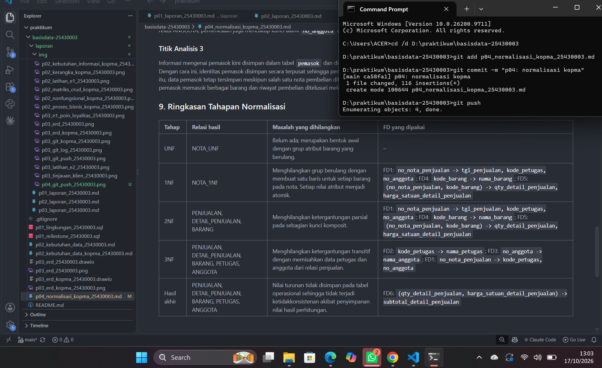
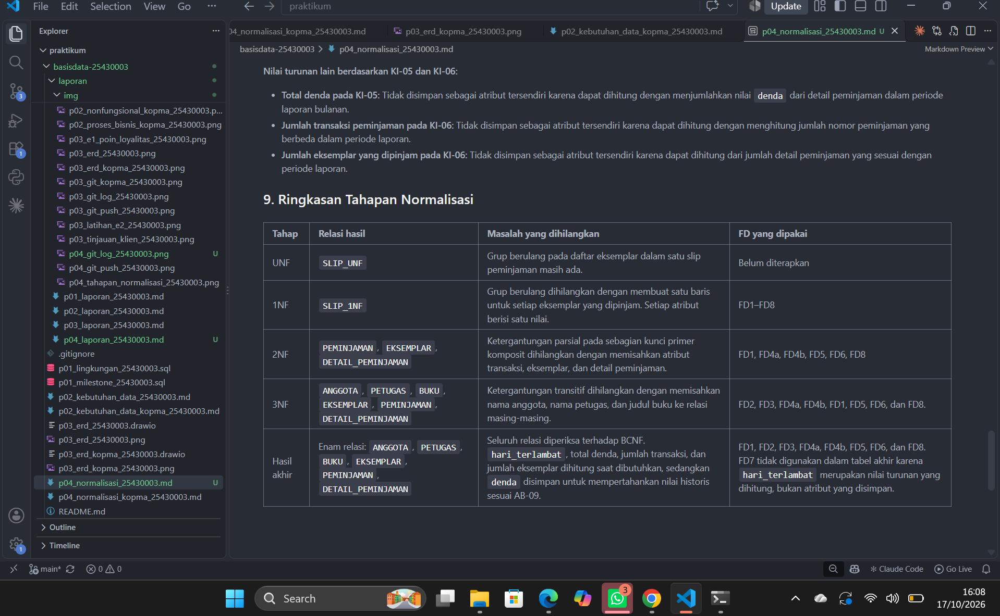
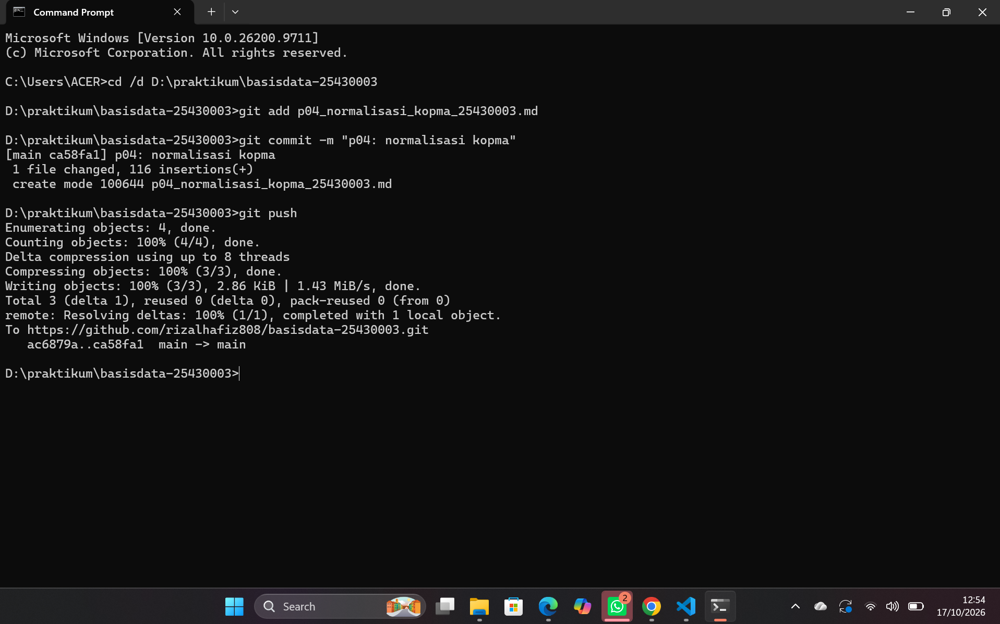
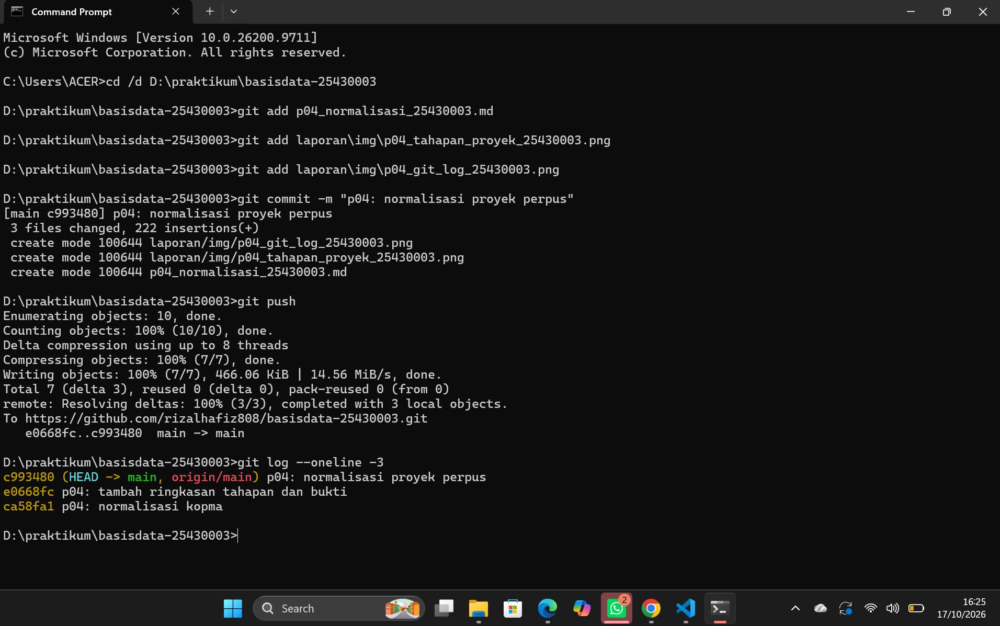
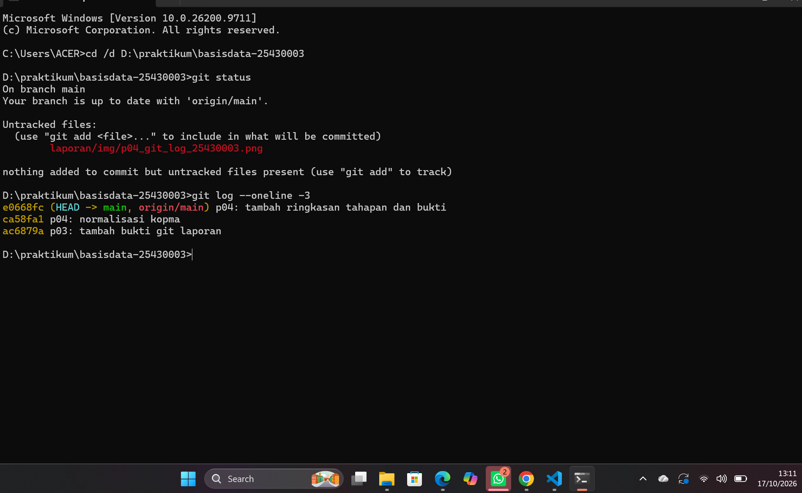
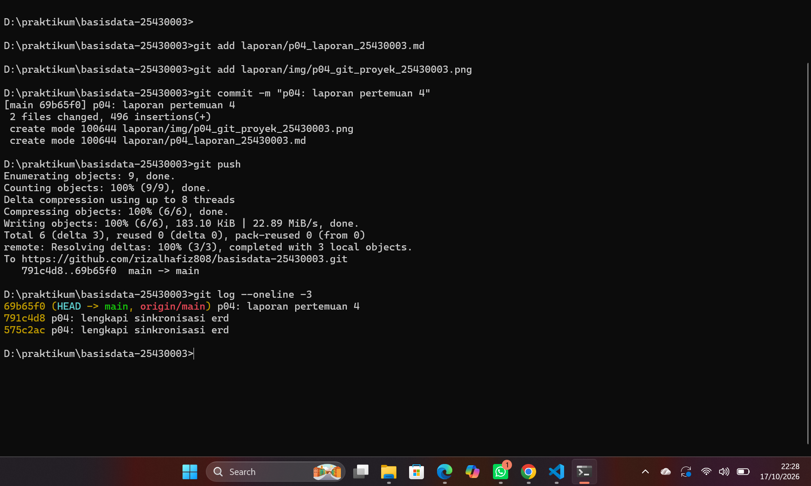

# Laporan Praktikum Basis Data - Pertemuan 04

**Nama:** Rizal Hafiz

**NIM:** 25430003

**Kelas:** A

**Pertemuan:** 4

**Dosen/Asisten:** [Dosen: Dedi Irawan,S.Kom., M.T.I]

**Tanggal:** 17 Oktober 2026

## 1. Tujuan Praktikum

1. Mengenali permasalahan perubahan, penambahan, dan penghapusan data yang muncul pada struktur data yang belum dinormalisasi.
2. Menentukan dependensi fungsional antaratribut berdasarkan aturan bisnis yang berlaku.
3. Melakukan normalisasi relasi secara bertahap hingga mencapai Third Normal Form (3NF), kemudian mengevaluasi apakah relasi tersebut memenuhi Boyce-Codd Normal Form (BCNF).
4. Menetapkan atribut turunan yang perlu disimpan atau cukup dihitung saat dibutuhkan, serta menyusun dokumentasi skema relasional akhir.

## 2. Ringkasan Dasar Teori

Normalisasi diperlukan untuk mengurangi masalah akibat penyimpanan data berulang dalam satu tabel. Anomali ubah terjadi ketika perubahan suatu fakta tidak diterapkan secara konsisten pada seluruh baris terkait. Anomali sisip terjadi ketika data baru tidak dapat ditambahkan tanpa adanya data lain. Anomali hapus terjadi ketika penghapusan suatu data ikut menghilangkan informasi lain yang masih diperlukan.

Dependensi fungsional adalah hubungan ketika suatu atribut menentukan satu nilai tertentu dari atribut lain. Penentuannya harus didasarkan pada aturan bisnis, bukan hanya contoh data. Normalisasi dilakukan melalui beberapa tahap, yaitu **1NF**, yang mensyaratkan nilai atribut bersifat atomik dan tidak memiliki grup berulang; **2NF**, yang menghilangkan ketergantungan atribut bukan kunci pada sebagian kunci komposit; **3NF**, yang menghilangkan ketergantungan transitif antaratribut bukan kunci; serta **BCNF**, yang mensyaratkan setiap determinan pada dependensi fungsional nontrivial merupakan kunci kandidat. Nilai turunan dapat disimpan jika diperlukan untuk mempertahankan catatan historis atau mempercepat kebutuhan tertentu, sedangkan nilai yang bisa dihitung kembali sebaiknya dihitung saat dibutuhkan agar tidak terjadi penyimpanan berulang yang tidak perlu.

## 3. Hasil Langkah Percobaan

### D.1 Dari UNF ke 1NF

Pada tahap ini, struktur nota penjualan yang masih memiliki grup berulang diubah menjadi bentuk 1NF agar setiap barang dalam satu nota dicatat pada baris tersendiri.

**Bentuk UNF:**

```
NOTA_UNF (no_nota_penjualan, tgl_penjualan, kode_petugas, nama_petugas, no_anggota, nama_anggota,
          { kode_barang, nama_barang, qty_detail_penjualan, harga_satuan_detail_penjualan, subtotal_detail_penjualan },
          jumlah_penjualan, diskon_penjualan, total_penjualan)
```

**Bentuk 1NF:**

```
NOTA_1NF (no_nota_penjualan, kode_barang, tgl_penjualan, kode_petugas, nama_petugas, no_anggota,
          nama_anggota, nama_barang, qty_detail_penjualan, harga_satuan_detail_penjualan,
          subtotal_detail_penjualan, jumlah_penjualan, diskon_penjualan, total_penjualan)
```

Grup berulang pada `NOTA_UNF` adalah `{ kode_barang, nama_barang, qty_detail_penjualan, harga_satuan_detail_penjualan, subtotal_detail_penjualan }` karena satu nota penjualan dapat memuat beberapa barang. Pada bentuk 1NF, setiap baris mewakili satu barang dalam satu nota, dengan kunci primer komposit `(no_nota_penjualan, kode_barang)`.

### D.2 Dependensi Fungsional

Berikut dependensi fungsional berdasarkan dokumen normalisasi Kopma:

- **FD1:** `no_nota_penjualan -> tgl_penjualan, kode_petugas, no_anggota` (AB-01)
- **FD2:** `kode_petugas -> nama_petugas`
- **FD3:** `no_anggota -> nama_anggota` (AB-05)
- **FD4:** `kode_barang -> nama_barang`
- **FD5:** `(no_nota_penjualan, kode_barang) -> qty_detail_penjualan, harga_satuan_detail_penjualan` (AB-04)
- **FD6:** `qty_detail_penjualan, harga_satuan_detail_penjualan -> subtotal_detail_penjualan` (turunan)

### D.3 Menuju 2NF dan 3NF

#### Langkah 4: 2NF

Untuk memenuhi bentuk normal kedua (2NF), saya memeriksa apakah ada atribut yang hanya bergantung pada sebagian kunci gabungan `(no_nota_penjualan, kode_barang)`. Berdasarkan FD1 dan FD4, atribut pada FD1 bergantung pada `no_nota_penjualan`, sedangkan atribut pada FD4 bergantung pada `kode_barang`. Artinya, kedua dependensi tersebut hanya menggunakan sebagian dari kunci gabungan. Oleh karena itu, relasi perlu dipecah agar setiap atribut nonkunci bergantung pada seluruh kunci primer, bukan hanya sebagian kunci.

```
PENJUALAN (no_nota_penjualan, tgl_penjualan, kode_petugas, nama_petugas, no_anggota, nama_anggota,
           jumlah_penjualan, diskon_penjualan, total_penjualan)
BARANG (kode_barang, nama_barang)
DETAIL_PENJUALAN (no_nota_penjualan*, kode_barang*, qty_detail_penjualan,
                  harga_satuan_detail_penjualan, subtotal_detail_penjualan)
-- * = kunci tamu
```

#### Langkah 5: 3NF

Pada tahap 3NF, saya memeriksa apakah terdapat ketergantungan transitif, yaitu ketika suatu atribut bergantung pada atribut nonkunci lain, bukan langsung pada kunci utama. Pada relasi penjualan, terdapat rantai `no_nota_penjualan → kode_petugas → nama_petugas` berdasarkan FD1 dan FD2, serta `no_nota_penjualan → no_anggota → nama_anggota` berdasarkan FD1 dan FD3. Artinya, nama petugas dapat ditentukan melalui kode petugas, sedangkan nama anggota dapat ditentukan melalui nomor anggota. Untuk menghindari ketergantungan transitif dan pengulangan data, informasi petugas dan anggota sebaiknya dipisahkan ke relasi masing-masing.

```
PENJUALAN (no_nota_penjualan, tgl_penjualan, kode_petugas*, no_anggota*,
           jumlah_penjualan, diskon_penjualan, total_penjualan)
PETUGAS (kode_petugas, nama_petugas)
ANGGOTA (no_anggota, nama_anggota)
-- * = kunci tamu
```

#### Langkah 6: Nilai Turunan

Atribut `subtotal_detail_penjualan` dapat dihitung dari `qty_detail_penjualan` dikalikan `harga_satuan_detail_penjualan`. Atribut `jumlah_penjualan` dapat dihitung dengan menjumlahkan seluruh subtotal barang dalam satu nota, sedangkan `diskon_penjualan` dapat ditentukan berdasarkan status keanggotaan dan aturan diskon yang berlaku. Atribut `total_penjualan` dihitung dari jumlah penjualan dikurangi diskon, sementara `bayar_penjualan` digunakan untuk mencatat jumlah uang yang dibayarkan pelanggan. Saya memutuskan bahwa nilai turunan seperti subtotal, jumlah penjualan, diskon, dan total penjualan dihitung dari data sumber saat dibutuhkan agar perubahan kuantitas, harga, atau status anggota tidak menyebabkan data menjadi tidak konsisten.

Relasi akhir hasil normalisasi:

```
PENJUALAN (no_nota_penjualan, tgl_penjualan, kode_petugas*, no_anggota*, bayar_penjualan)
DETAIL_PENJUALAN (no_nota_penjualan*, kode_barang*, qty_detail_penjualan, harga_satuan_detail_penjualan)
BARANG (kode_barang, nama_barang, kategori_barang, harga_jual_barang, stok_barang, stok_min_barang)
PETUGAS (kode_petugas, nama_petugas, peran_petugas)
ANGGOTA (no_anggota, nim_anggota, nama_anggota, prodi_anggota, no_hp_anggota, status_anggota, tgl_daftar_anggota)
-- * = kunci tamu
```

#### Ringkasan Tahapan



Gambar di atas merangkum tahapan normalisasi Kopma dari UNF hingga hasil akhir beserta FD yang dipakai pada tiap tahap.

### D.4 Skema Kanonik dan BCNF

#### Langkah 7: Perbandingan dengan Skema Kanonik

| Relasi | PK hasil normalisasi | PK kanonik | Kunci unik kanonik | Kunci tamu kanonik |
|---|---|---|---|---|
| PENJUALAN | no_nota_penjualan | id_penjualan | no_nota_penjualan | id_petugas, id_anggota (boleh NULL) |
| DETAIL_PENJUALAN | (no_nota_penjualan, kode_barang) | (id_penjualan, id_barang) | – | id_penjualan, id_barang |
| BARANG | kode_barang | id_barang | kode_barang | – |
| PETUGAS | kode_petugas | id_petugas | kode_petugas | – |
| ANGGOTA | no_anggota | id_anggota | no_anggota, nim_anggota | – |

Perbedaan utamanya adalah skema hasil normalisasi menggunakan kode alami sebagai kunci primer, sedangkan skema kanonik menggunakan kunci pengganti `id_*` sebagai kunci primer dan mempertahankan kode alami sebagai kunci unik.

#### Langkah 8: Pemeriksaan BCNF

| Relasi | Penentu (sisi kiri FD) | Kunci kandidat? | Hasil |
|---|---|---|---|
| PENJUALAN | no_nota_penjualan | Ya | Memenuhi BCNF |
| DETAIL_PENJUALAN | (no_nota_penjualan, kode_barang) | Ya | Memenuhi BCNF |
| BARANG | kode_barang | Ya | Memenuhi BCNF |
| PETUGAS | kode_petugas | Ya | Memenuhi BCNF |
| ANGGOTA | no_anggota, nim_anggota | Ya, keduanya merupakan kunci kandidat alami | Memenuhi BCNF |

Catatan pemeriksaan:
- PENJUALAN: no_nota_penjualan menentukan data penjualan pada satu nota.
- DETAIL_PENJUALAN: Kombinasi no_nota_penjualan dan kode_barang menentukan jumlah serta harga satuan barang pada detail nota.
- BARANG: kode_barang menentukan data barang.
- PETUGAS: kode_petugas menentukan data petugas.
- ANGGOTA: no_anggota dan nim_anggota merupakan kunci unik alami. Keduanya perlu diperiksa, bukan hanya id_anggota sebagai kunci pengganti.

**Kesimpulan:** Berdasarkan FD1–FD5 dan kunci unik pada Tabel 4.2, kelima relasi memenuhi BCNF karena setiap penentu yang diperiksa merupakan kunci kandidat. Pada relasi ANGGOTA, pemeriksaan juga mencakup kunci alami `no_anggota` dan `nim_anggota`, bukan hanya kunci pengganti `id_anggota`.

## 4. Jawaban Titik Analisis

### Titik Analisis 1

Mengapa FD5 menempatkan harga_satuan_detail_penjualan pada kunci (no_nota_penjualan, kode_barang), bukan pada kode_barang     saja? 

karena harga barang pada saat transaksi dapat berbeda dari harga barang saat ini. Satu barang bisa dijual dengan harga berbeda pada nota yang berbeda, sehingga kode_barang saja tidak cukup untuk menentukan harga saat transaksi.

Apa yang terjadi pada laporan omzet tahun lalu jika harga_satuan_detail_penjualan 
dipindah ke tabel barang?

Jika harga_satuan_detail_penjualan dipindahkan ke tabel barang, perubahan harga barang saat ini dapat menyebabkan harga transaksi lama tidak tercatat dengan benar. Akibatnya, laporan omzet tahun lalu bisa menjadi tidak akurat karena perhitungan menggunakan harga barang saat ini, bukan harga saat transaksi terjadi.

### Titik Analisis 2

Keputusan “total tidak disimpan” akan ditinjau ulang di Buku 2 Modul 2, ketika tabel 
arsip penjualan justru menyimpan total. Mengapa keputusan yang berbeda itu tetap 
konsisten? Petunjuk: bedakan data operasional yang masih dapat berubah dari potret 
historis yang tidak boleh berubah.

jawaban

Menurut saya, kedua keputusan tersebut tetap konsisten karena memiliki tujuan yang berbeda. Pada tabel operasional, total penjualan dihitung dari detail transaksi agar nilainya selalu sesuai dengan kuantitas dan harga saat transaksi berlangsung. Sementara itu, tabel arsip menyimpan total sebagai potret historis agar catatan transaksi masa lalu tetap sama dan tidak berubah ketika data barang diperbarui. Contohnya, jika harga pulpen tahun lalu Rp4.000 lalu naik menjadi Rp4.500, menghitung ulang total arsip menggunakan harga sekarang akan membuat total nota tahun lalu menjadi lebih besar dari transaksi aslinya, sehingga laporan omzet historis menjadi tidak akurat.

### Titik Analisis 3

Kolom pemasok_brg di spreadsheet lama tidak muncul di tabel barang. Di mana 
informasi “barang ini dipasok oleh siapa” kini disimpan? Apa keuntungannya dibanding 
menyimpan satu nama pemasok di tabel barang?

jawaban

Informasi mengenai pemasok kini disimpan dalam tabel `pemasok` dan dihubungkan dengan transaksi pembelian melalui tabel `pembelian` serta `detail_pembelian`. Dengan struktur ini, satu pemasok dapat memasok berbagai barang dan riwayat pembelian dapat ditelusuri dengan lebih mudah.

Keuntungannya, identitas pemasok tersimpan secara terpusat sehingga tidak terjadi pengulangan nama pemasok di tabel barang. Selain itu, satu barang dapat diperoleh dari pemasok yang berbeda melalui transaksi pembelian, dan data pemasok tetap tersimpan meskipun salah satu nota pembelian dihapus. Struktur ini membuat data lebih konsisten dan mengurangi risiko kehilangan informasi pemasok.

## 5. Hasil Latihan dan Modifikasi

### E.1

#### 1. Pelanggaran Bentuk Normal

Jika beberapa nomor telepon disimpan dalam satu kolom `telepon_pemasok`, maka terjadi pelanggaran First Normal Form (1NF) karena nilai dalam kolom tersebut tidak atomik. Oleh karena itu, setiap nomor telepon perlu disimpan sebagai nilai terpisah dalam tabel baru. Kolom `telepon_pemasok` kemudian dihapus dari tabel `pemasok` agar data nomor telepon dikelola melalui relasi tersendiri.

#### 2. Relasi Baru

```
PEMASOK_TELEPON (id_pemasok*, no_telepon_pemasok)
-- PK: (id_pemasok, no_telepon_pemasok)
-- * = kunci tamu
```

Keterangan:
- **PK:** `(id_pemasok, no_telepon_pemasok)`
- **FK:** `id_pemasok` mengacu pada `pemasok(id_pemasok)`.

#### 3. Alasan Pemilihan PK

Kunci primer gabungan `(id_pemasok, no_telepon_pemasok)` dipilih agar satu pemasok dapat memiliki beberapa nomor telepon, tetapi nomor telepon yang sama tidak tercatat berulang untuk pemasok yang sama.

### E.2

#### E.2a. Contoh Data Tabel Penjualan

| no_nota_penjualan | tgl_penjualan | no_anggota | nama_anggota |
|---|---|---|---|
| NT001 | 2026-10-01 | AG001 | Budi Santoso |
| NT002 | 2026-10-03 | AG001 | Budi Santoso |
| NT003 | 2026-10-05 | AG002 | Siti Aminah |

#### E.2b. Rantai Ketergantungan yang Dilanggar

Rantai ketergantungan transitif yang dilanggar adalah `no_nota_penjualan → no_anggota → nama_anggota`, karena `nama_anggota` bergantung pada `no_anggota`, bukan secara langsung pada nomor nota penjualan.

#### E.2c. Kueri UPDATE

```sql
UPDATE penjualan
SET nama_anggota = 'Budi S.'
WHERE no_nota_penjualan = 'NT001';
```

#### E.2d. Anomali Ubah

Setelah kueri dijalankan, nama anggota AG001 pada nota NT001 berubah menjadi Budi S., sedangkan pada nota NT002 masih tertulis Budi Santoso. Akibatnya, data menjadi tidak konsisten karena anggota dengan `no_anggota` yang sama memiliki dua penulisan nama berbeda.

## 6. Tugas Mandiri: Milestone Proyek 04

### 6.1 UNF dan 1NF

Dokumen sumber yang digunakan sebagai titik awal normalisasi adalah **Slip Peminjaman Buku** dari Pertemuan 2, Bagian 3.1. Pada proyek Perpustakaan Cendekia RH, data slip peminjaman yang masih memiliki grup berulang diubah menjadi bentuk 1NF. Setiap eksemplar buku dicatat pada baris tersendiri agar nilai setiap atribut bersifat atomik.

**Bentuk UNF:**

```
SLIP_UNF (
    nomor_peminjaman, tanggal_peminjaman, id_anggota, nama_anggota,
    id_petugas, nama_petugas,
    { no, id_eksemplar, judul_buku, tanggal_jatuh_tempo,
      tanggal_pengembalian, hari_terlambat, denda }
)
```

Grup berulang adalah `{ no, id_eksemplar, judul_buku, tanggal_jatuh_tempo, tanggal_pengembalian, hari_terlambat, denda }` karena satu transaksi peminjaman dapat mencakup beberapa eksemplar buku.

**Bentuk 1NF:**

```
SLIP_1NF (
    nomor_peminjaman, id_eksemplar, tanggal_peminjaman,
    id_anggota, nama_anggota, id_petugas, nama_petugas,
    judul_buku, tanggal_jatuh_tempo, tanggal_pengembalian,
    hari_terlambat, denda
)
```

Setiap baris mewakili satu eksemplar dalam satu transaksi peminjaman. Kunci primer kompositnya adalah `(nomor_peminjaman, id_eksemplar)`. Atribut `no` tidak disertakan dalam bentuk 1NF karena hanya berfungsi sebagai nomor urut tampilan, bukan sebagai atribut utama untuk mengidentifikasi data peminjaman.

### 6.2 Dependensi Fungsional

FD1: `nomor_peminjaman -> tanggal_peminjaman, id_anggota, id_petugas` (AB-04)

FD2: `id_anggota -> nama_anggota` (AB-01 dan Bagian 4 P02)

FD3: `id_petugas -> nama_petugas` (AB-04 dan Bagian 4 P02)

FD4a: `id_eksemplar -> id_buku` (AB-03 dan Kamus Data P02 Bagian 8 nomor 20–21)

FD4b: `id_buku -> judul_buku` (AB-02 dan Kamus Data P02 Bagian 8 nomor 13–14)

FD5: `(nomor_peminjaman, id_eksemplar) -> tanggal_jatuh_tempo` (AB-06)

FD6: `(nomor_peminjaman, id_eksemplar) -> tanggal_pengembalian` (Bagian 3.2 P02)

FD7: `tanggal_jatuh_tempo, tanggal_pengembalian -> hari_terlambat` (turunan, AB-08 dan P02 Bagian 3.2)

FD8: `(nomor_peminjaman, id_eksemplar) -> denda` (AB-09)

### 6.3 2NF dan 3NF

Pada relasi `SLIP_1NF`, kunci primer kompositnya adalah `(nomor_peminjaman, id_eksemplar)`. Atribut `tanggal_peminjaman`, `id_anggota`, dan `id_petugas` hanya bergantung pada `nomor_peminjaman`, sedangkan `judul_buku` bergantung pada `id_eksemplar`. Dengan demikian, terdapat atribut yang hanya bergantung pada sebagian kunci primer. Untuk memenuhi 2NF, atribut-atribut tersebut perlu dipisahkan ke dalam relasi yang sesuai.

```
PEMINJAMAN (
    nomor_peminjaman (PK),
    tanggal_peminjaman,
    id_anggota*,
    nama_anggota,
    id_petugas*,
    nama_petugas
)

EKSEMPLAR (
    id_eksemplar (PK),
    judul_buku
)

DETAIL_PEMINJAMAN (
    nomor_peminjaman* (PK),
    id_eksemplar* (PK),
    tanggal_jatuh_tempo,
    tanggal_pengembalian,
    hari_terlambat,
    denda
)
```

Keterangan:
- PK = Primary Key (kunci primer).
- Tanda * = Foreign Key (kunci tamu).
- PEMINJAMAN menyimpan informasi utama transaksi.
- EKSEMPLAR menyimpan identitas eksemplar dan judul buku.
- DETAIL_PEMINJAMAN menyimpan informasi setiap eksemplar dalam transaksi.

Catatan: Relasi di atas merupakan pemisahan untuk menghilangkan ketergantungan parsial. Ketergantungan transitif seperti `id_anggota -> nama_anggota` dan `id_petugas -> nama_petugas` masih ada pada `PEMINJAMAN`, sehingga perlu ditangani saat menuju 3NF.

Berdasarkan pemeriksaan ketiga relasi hasil 2NF, ditemukan tiga rantai ketergantungan transitif. Pertama, pada relasi `PEMINJAMAN`, terdapat rantai `nomor_peminjaman -> id_anggota -> nama_anggota`, karena nomor peminjaman menentukan anggota yang meminjam, sedangkan ID anggota menentukan nama anggota (AB-01 dan AB-04). Kedua, terdapat rantai `nomor_peminjaman -> id_petugas -> nama_petugas`, karena nomor peminjaman menentukan petugas yang melayani, sedangkan ID petugas menentukan nama petugas (AB-04). Ketiga, pada relasi `EKSEMPLAR`, terdapat rantai `id_eksemplar -> id_buku -> judul_buku`. Berdasarkan AB-03, setiap eksemplar terhubung dengan satu judul buku, sedangkan satu judul buku dapat memiliki beberapa eksemplar. Kamus data P02 Bagian 8 nomor 13–14 menunjukkan bahwa `id_buku` dan `judul_buku` merupakan atribut entitas Buku, sedangkan nomor 20–21 menunjukkan bahwa `id_eksemplar` dan `id_buku` merupakan atribut entitas Eksemplar. Oleh karena itu, atribut nama anggota, nama petugas, dan judul buku perlu dipisahkan ke relasi masing-masing agar tidak terjadi ketergantungan transitif.

```
ANGGOTA (
    id_anggota (PK),
    nama_anggota
)

PETUGAS (
    id_petugas (PK),
    nama_petugas
)

BUKU (
    id_buku (PK),
    judul_buku
)

EKSEMPLAR (
    id_eksemplar (PK),
    id_buku (FK)
)

PEMINJAMAN (
    nomor_peminjaman (PK),
    tanggal_peminjaman,
    id_anggota (FK),
    id_petugas (FK)
)

DETAIL_PEMINJAMAN (
    nomor_peminjaman (PK, FK),
    id_eksemplar (PK, FK),
    tanggal_jatuh_tempo,
    tanggal_pengembalian,
    denda
)
```

Keterangan:
- PK = Primary Key, yaitu kunci primer.
- FK = Foreign Key, yaitu kunci tamu yang merujuk ke relasi lain.
- Relasi ANGGOTA, PETUGAS, dan BUKU menyimpan data induk masing-masing.
- Relasi EKSEMPLAR menghubungkan setiap buku fisik dengan judul buku melalui id_buku.
- Relasi PEMINJAMAN menyimpan informasi utama transaksi serta ID anggota dan petugas yang terkait.
- Relasi DETAIL_PEMINJAMAN menyimpan informasi setiap eksemplar dalam transaksi. Pasangan nomor_peminjaman dan id_eksemplar menjadi PK komposit.
- hari_terlambat tidak disimpan sebagai atribut karena nilainya dihitung dari tanggal jatuh tempo dan tanggal pengembalian, atau tanggal pemeriksaan jika buku belum dikembalikan. Denda tetap disimpan sesuai aturan AB-09.


**Catatan:** Pemisahan ini menghilangkan tiga rantai ketergantungan transitif yang ditemukan pada relasi 2NF dan menempatkan atribut pada relasi sesuai kepemilikannya dalam kamus data P02.

### 6.4 Pemeriksaan BCNF

| Relasi | FD yang berlaku | Penentu (sisi kiri FD) | Kunci kandidat? | Hasil |
|---|---|---|---|---|
| ANGGOTA | FD2: `id_anggota -> nama_anggota` | `id_anggota` | Ya | Memenuhi BCNF |
| PETUGAS | FD3: `id_petugas -> nama_petugas` | `id_petugas` | Ya | Memenuhi BCNF |
| BUKU | FD4b: `id_buku -> judul_buku` | `id_buku` | Ya | Memenuhi BCNF |
| EKSEMPLAR | FD4a: `id_eksemplar -> id_buku` | `id_eksemplar` | Ya | Memenuhi BCNF |
| PEMINJAMAN | FD1: `nomor_peminjaman -> tanggal_peminjaman, id_anggota, id_petugas` | `nomor_peminjaman` | Ya | Memenuhi BCNF |
| DETAIL_PEMINJAMAN | FD5, FD6, FD8: `(nomor_peminjaman, id_eksemplar) -> tanggal_jatuh_tempo, tanggal_pengembalian, denda` | `(nomor_peminjaman, id_eksemplar)` | Ya | Memenuhi BCNF |

Kesimpulan: Keenam relasi memenuhi BCNF karena setiap penentu dalam dependensi fungsional nontrivial yang berlaku pada relasinya merupakan kunci kandidat.

### 6.5 Keputusan Nilai Turunan

**Keputusan `hari_terlambat`:** Nilai `hari_terlambat` tidak disimpan sebagai atribut tetap, tetapi dihitung berdasarkan selisih tanggal jatuh tempo dan tanggal pengembalian. Jika buku belum dikembalikan dan sudah melewati tanggal jatuh tempo, jumlah hari keterlambatan dihitung sampai tanggal pemeriksaan. Keputusan ini sesuai dengan AB-08 dan P02 Bagian 3.2 karena jumlah hari keterlambatan dapat diperoleh dari tanggal yang sudah tersimpan.

**Keputusan `denda`:** Nilai `denda` dihitung saat eksemplar dikembalikan berdasarkan jumlah hari keterlambatan dan tarif yang berlaku, kemudian disimpan pada detail peminjaman. Sesuai AB-09 dan P02 Bagian 3.2, penyimpanan ini diperlukan agar catatan denda transaksi lama tidak berubah ketika tarif denda di masa depan mengalami perubahan.

**Perbedaan dengan `total_penjualan` pada kasus Kopma:** Nilai `denda` disimpan karena harus mempertahankan nilai historis berdasarkan tarif saat pengembalian, sedangkan `total_penjualan` pada kasus Kopma dapat dihitung dari data transaksi penjualan sehingga tidak perlu disimpan sebagai nilai turunan yang berpotensi tidak konsisten.

Pada kasus Kopma, harga historis sudah tersimpan pada detail penjualan melalui atribut `harga_satuan_detail_penjualan` sesuai AB-04, sehingga `total_penjualan` dapat dihitung kembali berdasarkan harga dan jumlah barang pada transaksi. Sebaliknya, pada Perpustakaan Cendekia RH, tarif denda historis tidak disimpan pada kolom tersendiri, sehingga nilai `denda` harus disimpan agar catatan denda lama tetap sesuai dengan tarif yang berlaku saat pengembalian.

**Nilai turunan lain berdasarkan KI-05 dan KI-06:**

- **Total denda pada KI-05:** Tidak disimpan sebagai atribut tersendiri karena dapat dihitung dengan menjumlahkan nilai `denda` dari detail peminjaman dalam periode laporan bulanan.
- **Jumlah transaksi peminjaman pada KI-06:** Tidak disimpan sebagai atribut tersendiri karena dapat dihitung dengan menghitung jumlah nomor peminjaman yang berbeda dalam periode laporan.
- **Jumlah eksemplar yang dipinjam pada KI-06:** Tidak disimpan sebagai atribut tersendiri karena dapat dihitung dari jumlah detail peminjaman yang sesuai dengan periode laporan.

### 6.6 Ringkasan Tahapan

| Tahap | Relasi hasil | Masalah yang dihilangkan | FD yang dipakai |
|---|---|---|---|
| UNF | `SLIP_UNF` | Grup berulang pada daftar eksemplar dalam satu slip peminjaman masih ada. | Belum diterapkan |
| 1NF | `SLIP_1NF` | Grup berulang dihilangkan dengan membuat satu baris untuk setiap eksemplar yang dipinjam. Setiap atribut berisi satu nilai. | FD1–FD8 |
| 2NF | `PEMINJAMAN`, `EKSEMPLAR`, `DETAIL_PEMINJAMAN` | Ketergantungan parsial pada sebagian kunci primer komposit dihilangkan dengan memisahkan atribut transaksi, eksemplar, dan detail peminjaman. | FD1, FD4a, FD4b, FD5, FD6, FD8 |
| 3NF | `ANGGOTA`, `PETUGAS`, `BUKU`, `EKSEMPLAR`, `PEMINJAMAN`, `DETAIL_PEMINJAMAN` | Ketergantungan transitif dihilangkan dengan memisahkan nama anggota, nama petugas, dan judul buku ke relasi masing-masing. | FD2, FD3, FD4a, FD4b, FD1, FD5, FD6, dan FD8. |
| Hasil akhir | Enam relasi: `ANGGOTA`, `PETUGAS`, `BUKU`, `EKSEMPLAR`, `PEMINJAMAN`, `DETAIL_PEMINJAMAN` | Seluruh relasi diperiksa terhadap BCNF. `hari_terlambat`, total denda, jumlah transaksi, dan jumlah eksemplar dihitung saat dibutuhkan, sedangkan `denda` disimpan untuk mempertahankan nilai historis sesuai AB-09. | FD1, FD2, FD3, FD4a, FD4b, FD5, FD6, dan FD8. FD7 tidak digunakan dalam tabel akhir karena `hari_terlambat` merupakan nilai turunan yang dihitung, bukan atribut yang disimpan. |



### 6.7 Sinkronisasi dengan ERD

**1. Entitas Kategori Buku dan Penerbit**

Entitas `kategori_buku` dan `penerbit` tetap dipertahankan dalam ERD karena berasal dari identifikasi entitas kandidat pada P02 Bagian 4 dan didukung oleh AB-10. Meskipun tidak muncul langsung pada slip peminjaman, kedua entitas diperlukan untuk menyimpan informasi kategori dan penerbit yang berhubungan dengan data buku.

**2. Pemeriksaan atribut nilai turunan**

ERD tetap dipertahankan karena atribut `hari_terlambat`, total denda, jumlah transaksi, dan jumlah eksemplar tidak dicantumkan sebagai atribut tersimpan. Nilai-nilai tersebut dihitung ketika diperlukan sesuai keputusan pada Bagian 6.5. Sementara itu, atribut `denda` tetap disimpan pada `detail_peminjaman` sesuai AB-09 agar catatan denda historis tidak berubah ketika tarif diperbarui.

**3. Pemeriksaan kunci primer Detail Peminjaman**

ERD tetap menggunakan `id_detail` sebagai kunci primer pada entitas `detail_peminjaman`, sesuai rancangan ERD awal dan kamus data P02 Bagian 8 nomor 29. Walaupun hasil normalisasi menetapkan pasangan `(nomor_peminjaman, id_eksemplar)` sebagai kunci primer komposit, `id_detail` tetap dipertahankan sebagai identitas unik detail peminjaman dalam ERD. Perbedaan ini dicatat sebagai keputusan rancangan agar identitas detail tetap menggunakan atribut yang telah ditetapkan dalam dokumen kebutuhan data.

Kunci unik gabungan `nomor_peminjaman` dan `id_eksemplar` dipertahankan supaya eksemplar yang sama tidak tercatat lebih dari sekali dalam satu transaksi peminjaman. Karena gabungan kedua atribut tersebut tetap menjadi kunci kandidat, kesimpulan pemeriksaan BCNF pada Bagian 6.4 tetap berlaku.

**Kesimpulan:** ERD tidak berubah. Entitas `kategori_buku` dan `penerbit` tetap dipertahankan karena merupakan bagian dari kebutuhan data P02, atribut nilai turunan tidak ditambahkan sebagai atribut tersimpan, dan `id_detail` tetap digunakan sebagai kunci primer sesuai rancangan ERD awal.

## 7. Pembahasan dan Kendala

### 7.1 Pembahasan

Melalui Modul 4, saya mempelajari bahwa normalisasi membantu mengurangi pengulangan data dan mencegah anomali saat data ditambah, diubah, atau dihapus. Pada proyek Kopma, harga satuan disimpan pada detail penjualan untuk mempertahankan harga yang digunakan saat transaksi berlangsung. Sementara itu, pada proyek Perpustakaan Cendekia RH, atribut `denda` tetap disimpan agar nilai denda historis tidak berubah ketika tarif diperbarui.

### 7.2 Kendala

Kendala yang saya alami adalah menentukan ketergantungan fungsional (FD) berdasarkan aturan bisnis dan membedakan atribut yang perlu disimpan dengan atribut yang dapat dihitung. Selain itu, saya juga perlu memastikan format tabel dan relasi tetap rapi ketika ditulis dalam Markdown.

### 7.3 Solusi

Untuk mengatasi kendala tersebut, saya memeriksa kembali aturan bisnis dan menentukan hubungan antara kunci dengan atribut yang bergantung padanya. Saya juga membandingkan hasil normalisasi dari setiap tahap serta memeriksa kembali format Markdown agar struktur relasi, tabel, dan penjelasan tersusun dengan baik.

## 8. Kesimpulan

Melalui Modul 4, normalisasi data Kopma menghasilkan relasi yang lebih terstruktur dengan memisahkan data penjualan, barang, petugas, anggota, dan detail penjualan sesuai ketergantungan fungsionalnya. Pada proyek Perpustakaan Cendekia RH, hasil akhirnya terdiri dari enam relasi, yaitu `ANGGOTA`, `PETUGAS`, `BUKU`, `EKSEMPLAR`, `PEMINJAMAN`, dan `DETAIL_PEMINJAMAN`. Atribut turunan seperti subtotal dan total penjualan pada Kopma serta hari keterlambatan dan jumlah eksemplar pada perpustakaan dihitung saat diperlukan, sehingga tidak perlu disimpan sebagai atribut tersendiri. Namun, harga satuan pada detail penjualan dan `denda` pada detail peminjaman tetap disimpan untuk mempertahankan nilai historis saat transaksi berlangsung.

## 9. Pernyataan Penggunaan AI

Dalam menyelesaikan proyek Modul 4, saya menggunakan AI Claude untuk membantu proses pengerjaan proyek dan AI ChatGPT untuk membantu memahami materi, menyusun penjelasan, serta memperbaiki struktur dan format laporan. Penggunaan AI ini bertujuan untuk mendukung proses pembelajaran dan penyelesaian tugas. Saya tetap bertanggung jawab untuk memeriksa kembali hasil pekerjaan agar sesuai dengan materi dan ketentuan tugas.

## 10. Bukti Git

**Tautan repositori:** https://github.com/rizalhafiz808/basisdata-25430003

| Hash | Pesan commit | Isi commit |
|---|---|---|
| `ca58fa1` | p04: normalisasi kopma | Menyusun hasil normalisasi data Kopma dari UNF hingga 3NF. |
| `e0668fc` | p04: tambah ringkasan tahapan dan bukti | Menambahkan ringkasan tahapan normalisasi dan bukti pendukung proyek. |
| `c993480` | p04: normalisasi proyek perpus | Menyusun hasil normalisasi data Perpustakaan Cendekia RH. |
| `575c2ac` | p04: lengkapi sinkronisasi erd | Melengkapi penjelasan kesesuaian hasil normalisasi dengan ERD. |
| `791c4d8` | p04: lengkapi sinkronisasi erd | Memperbarui dan menyempurnakan penjelasan sinkronisasi ERD. |
| `69b65f0` | p04: laporan pertemuan 4 | Laporan Pertemuan 4 |









## Checklist

### Checklist Umum

| ✓ | **Butir** | **Yang harus ada** |
|---|---|---|
| ☑ | **Identitas** | Nama, NIM, kelas, pertemuan ke-N, tanggal pelaksanaan, nama asisten/dosen |
| ☑ | **Tujuan** | Tujuan praktikum ditulis ulang dengan bahasa sendiri (maksimal 5 baris) |
| ☑ | **Ringkasan teori** | Pemahaman sendiri atas Dasar Teori, maksimal setengah halaman, tanpa menyalin |
| ☑ | **Langkah percobaan (D)** | Tangkapan layar hasil langkah kunci sesuai checklist khusus, masing-masing diberi keterangan singkat |
| ☑ | **Titik Analisis** | Semua Titik Analisis dijawab lengkap dengan alasan, bukan sekadar ya/tidak |
| ☑ | **Latihan (E)** | Skrip/dokumen hasil latihan beserta bukti berjalan |
| ☑ | **Tugas Mandiri (F)** | Milestone proyek pertemuan ini: berkas, bukti, dan penjelasan keputusan desain |
| ☑ | **Pembahasan dan kendala** | Galat yang ditemui, cara membacanya, dan cara mengatasinya |
| ☑ | **Kesimpulan** | Dua sampai empat kalimat dengan bahasa sendiri |
| ☑ | **Pernyataan Penggunaan AI** | Alat yang dipakai, untuk apa, bagian mana; tulis “tidak menggunakan” bila tidak memakai |
| ☑ | **Bukti Git** | Tautan repositori dan kode commit (hash) pertemuan ini dengan pesan `pNN: ...` |
| ☑ | **Keaslian** | Setiap tangkapan layar memperlihatkan akun ber-NIM dan jam sistem; nama objek memuat NIM/inisial |

### Checklist Khusus Pertemuan 4

| Jenis | Yang harus ada | Status |
|---|---|---|
| Berkas wajib | `p04_normalisasi_<NIM>.md` (proyek) | [☑] |
| Bukti tangkapan layar | Tabel tahapan UNF → 1NF → 2NF → 3NF | [☑] |
| Analisis wajib | Daftar dependensi fungsional; keputusan menyimpan atau menghitung nilai turunan beserta alasannya | [☑] |