# Laporan Praktikum Basis Data - Pertemuan 05

**Nama:** Rizal Hafiz

**NIM:** 25430003

**Kelas:** A

**Pertemuan:** 5

**Dosen/Asisten:** [Dosen: Dedi Irawan,S.Kom., M.T.I]

**Tanggal:** 19 Oktober 2026

## 1. Tujuan Praktikum

1. Mengubah skema relasional 3NF menjadi perintah `CREATE TABLE` dengan tipe data yang tepat.
2. Menerapkan constraint PRIMARY KEY, FOREIGN KEY, UNIQUE, NOT NULL, DEFAULT, dan CHECK sesuai aturan bisnis.
3. Mengubah dan menghapus struktur tabel dengan `ALTER TABLE` dan `DROP TABLE` dalam urutan yang benar.
4. Membuktikan bahwa constraint menolak data yang salah, lalu membandingkan desain fisik dengan ERD.

## 2. Ringkasan Dasar Teori

DDL (Data Definition Language) adalah bagian SQL untuk membuat, mengubah, dan menghapus struktur basis data. Memilih tipe data termasuk keputusan desain. Uang disimpan sebagai `DECIMAL` supaya tidak terjadi galat pembulatan, kode disimpan sebagai `CHAR`/`VARCHAR` karena tidak dihitung, dan nilai yang pilihannya terbatas disimpan sebagai `ENUM`.

Constraint memindahkan aturan bisnis dari "disiplin pengguna" menjadi "jaminan server". PRIMARY KEY dan UNIQUE mencegah data ganda, FOREIGN KEY memastikan data anak selalu merujuk data induk yang ada, dan CHECK menolak nilai yang melanggar aturan pada satu baris. Sejak MariaDB 10.2, CHECK benar-benar ditegakkan. Namun, CHECK tidak bisa memeriksa aturan yang melibatkan banyak baris atau tabel lain.

Tabel induk harus dibuat sebelum tabel anak, dan dihapus sesudahnya. Karena itu, `DROP TABLE IF EXISTS` di awal skrip ditulis dengan urutan terbalik, supaya skrip bisa dijalankan ulang dari basis data kosong.

## 3. Hasil Langkah Percobaan

Seluruh langkah dikerjakan pada basis data `kopma_003` dengan akun `mhs_003`, memakai skrip `p05_ddl_kopma_25430003.sql`.

### 3.1 Membuat Tabel Induk dan Tabel Transaksi (D.1–D.2)

Tabel dibuat berurutan dari induk ke anak: `petugas`, `anggota`, `barang`, `pemasok`, `penjualan`, `detail_penjualan`, `pembelian`, `detail_pembelian`. Kolom kunci tamu diberi tipe yang sama persis dengan kolom induknya, misalnya `penjualan.id_petugas` bertipe SMALLINT seperti `petugas.id_petugas`.

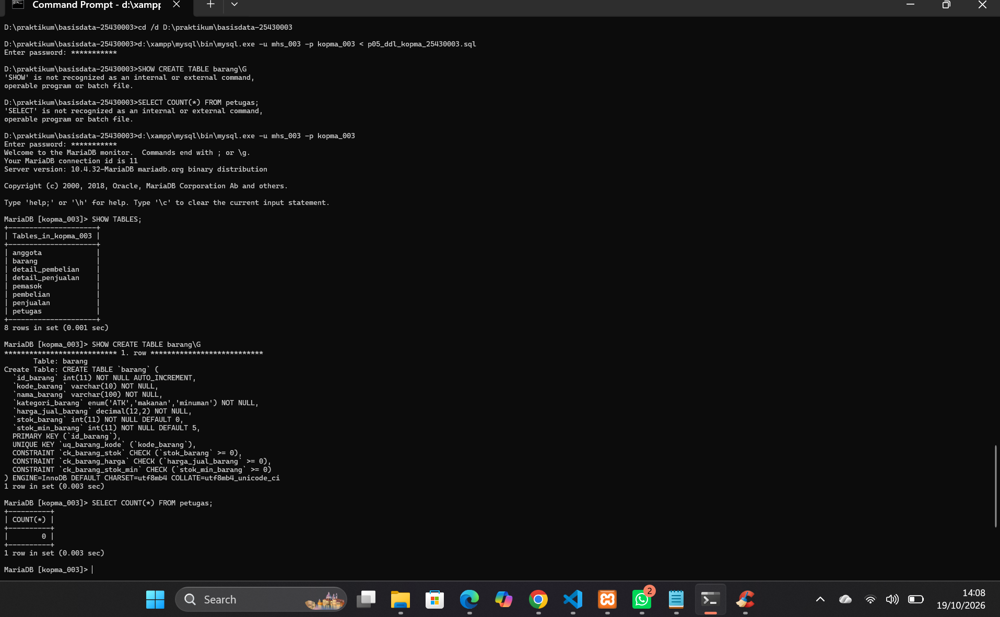

*Gambar 3.1 Skrip `p05_ddl_kopma_25430003.sql` dijalankan sebagai `mhs_003`. Delapan tabel Kopma terbentuk, dan `SHOW CREATE TABLE barang` menampilkan kunci unik `uq_barang_kode` serta constraint CHECK `ck_barang_stok`, `ck_barang_harga`, dan `ck_barang_stok_min`.*

### 3.2 Membuktikan Constraint Bekerja (D.3)

Setelah data induk diisi (dua petugas, dua barang), tiga perintah yang melanggar aturan dijalankan, dan ketiganya ditolak server.

| Perintah | Hasil | Constraint |
|---|---|---|
| Nota dengan `id_petugas` 99 | ERROR 1452 | `fk_penjualan_petugas` |
| `stok_barang = -1` | ERROR 4025 | `ck_barang_stok` |
| Barang dengan kode `ATK-001` kembar | ERROR 1062 | `uq_barang_kode` |

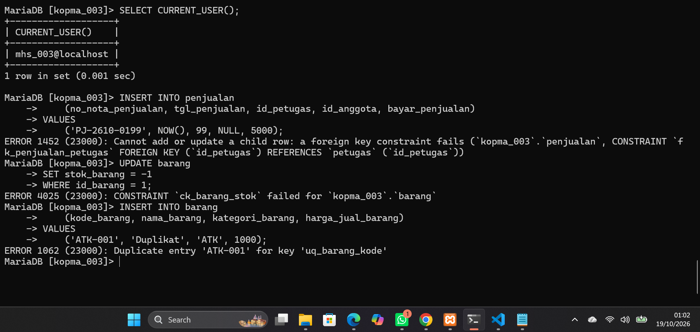

*Gambar 3.2 Akun `mhs_003@localhost`. Server menolak kunci tamu yang tidak dikenal, stok negatif, dan kode barang kembar.*

### 3.3 Mengubah Struktur dan Membandingkan dengan ERD (D.4)

Kolom `tgl_kedaluwarsa` ditambahkan dengan `ALTER TABLE ... ADD COLUMN` tanpa membuat ulang tabel, lalu dihapus kembali dengan `DROP COLUMN`. Skrip kemudian dilengkapi blok `DROP TABLE IF EXISTS` dengan urutan anak ke induk, supaya bisa dijalankan ulang.

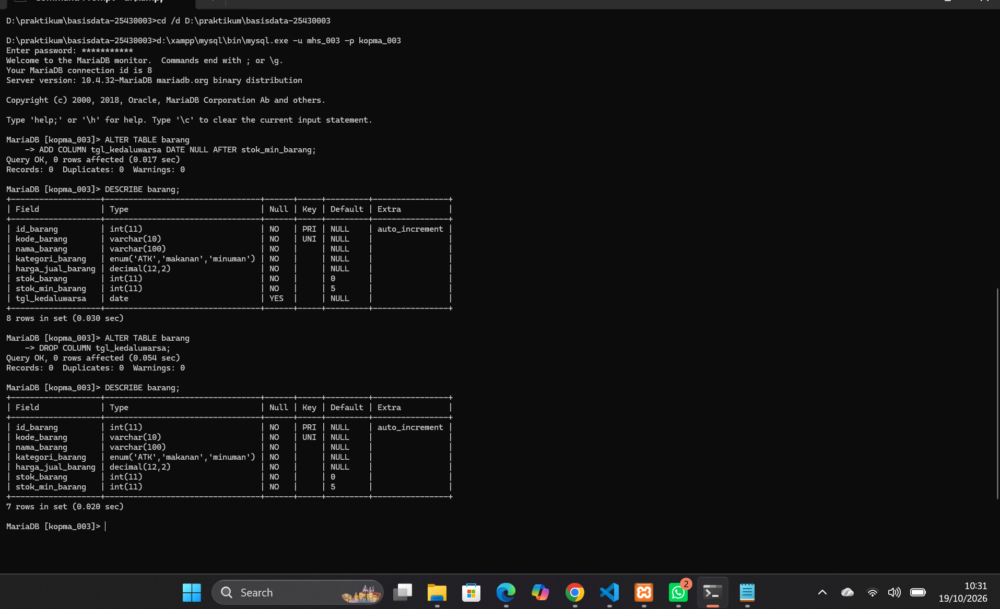

*Gambar 3.3 `DESCRIBE barang` sebelum dan sesudah: kolom `tgl_kedaluwarsa` muncul setelah `stok_min_barang` (8 kolom), lalu hilang kembali setelah `DROP COLUMN` (7 kolom).*

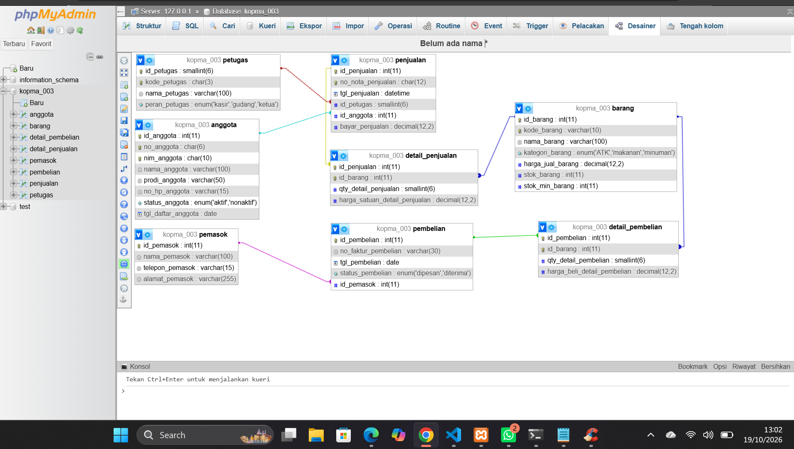

*Gambar 3.4 Tampilan Designer `kopma_003`. Delapan tabel dan tujuh garis relasi sesuai dengan ERD fisik Kopma.*

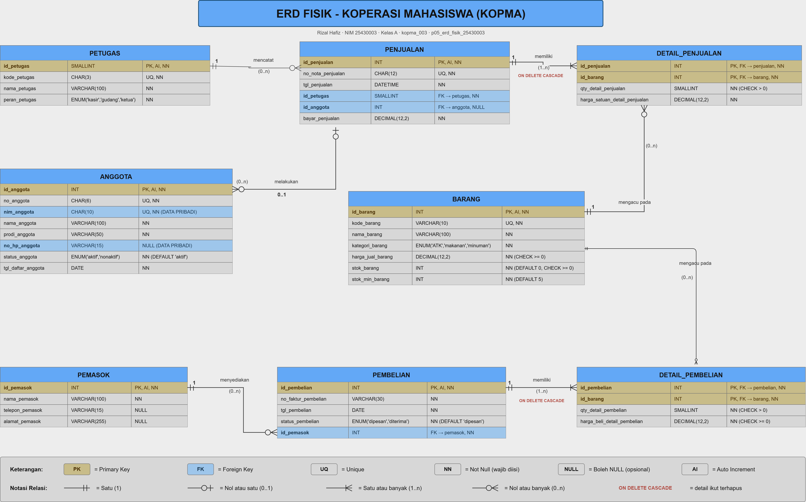

*Gambar 3.5 ERD fisik Kopma. Tipe data, constraint, dan aksi ON DELETE CASCADE dicantumkan sesuai skrip DDL.*

## 4. Jawaban Titik Analisis

**Titik Analisis 1**

`fk_detail_penjualan` memakai `ON DELETE CASCADE` karena baris detail adalah bagian dari nota. Kalau sebuah nota dibatalkan, rinciannya tidak punya arti lagi dan memang harus ikut terhapus.

Sebaliknya, `fk_detail_barang` tidak memakai CASCADE karena barang adalah data master yang dirujuk oleh banyak nota. Seandainya barang boleh dihapus beserta seluruh detailnya, semua riwayat penjualan barang itu ikut hilang. Akibatnya, laporan omzet dan barang terlaris periode lalu berubah dan tidak bisa dipercaya lagi. Dengan aturan bawaan (RESTRICT), server menolak penghapusan barang yang sudah pernah terjual (ERROR 1451). Barang seperti ini sebaiknya cukup dihentikan penjualannya, bukan dihapus.

**Titik Analisis 2**

| Kode galat | Constraint | Aturan yang dilindungi |
|---|---|---|
| 1452 | `fk_penjualan_petugas` | Setiap nota harus dilayani petugas yang terdaftar ("jangan ada nota tanpa kasir"), bagian dari keabsahan nota pada AB-01 |
| 4025 | `ck_barang_stok` | AB-03: stok barang tidak boleh negatif |
| 1062 | `uq_barang_kode` | Kode barang harus unik supaya setiap barang teridentifikasi tepat satu. Prinsipnya sama dengan keunikan nomor nota (AB-01) dan NIM anggota (AB-05) |

Aturan Kopma yang belum bisa dijaga oleh constraint apa pun:
- **AB-01, bagian "minimal satu baris barang".** Aturan ini menyangkut jumlah baris di `detail_penjualan`, sedangkan CHECK hanya memeriksa satu baris.
- **AB-02.** Diskon 5% hanya untuk anggota berstatus aktif, padahal status anggota ada di tabel lain.
- **AB-03, bagian "penjualan ditolak bila qty melebihi stok".** Perbandingan qty dengan stok melibatkan dua tabel.
- **AB-06.** Pesanan pembelian dibuat bila stok di bawah minimum. Ini sebuah proses, bukan batasan data.

Aturan-aturan tersebut akan dijaga dengan transaksi pada Modul 14.

**Titik Analisis 3**

`DROP TABLE IF EXISTS` harus dimulai dari `detail_pembelian` dan `detail_penjualan`, karena kedua tabel itu adalah tabel anak yang menyimpan kunci tamu ke tabel lain. Selama tabel anak masih ada, tabel induk seperti `petugas`, `barang`, dan `penjualan` masih dirujuk dan tidak boleh dihapus.

Kalau urutannya dibalik (dimulai dari `petugas`), server menolak dengan pesan:

```
ERROR 1451 (23000): Cannot delete or update a parent row: a foreign key constraint fails
```

Hal ini dibuktikan dengan menjalankan `DROP TABLE petugas;` saat tabel `penjualan` masih ada. Server menolak, dan kedelapan tabel tetap utuh. Akibatnya, skrip yang urutan DROP-nya salah akan berhenti di tengah dan tidak bisa dijalankan ulang.

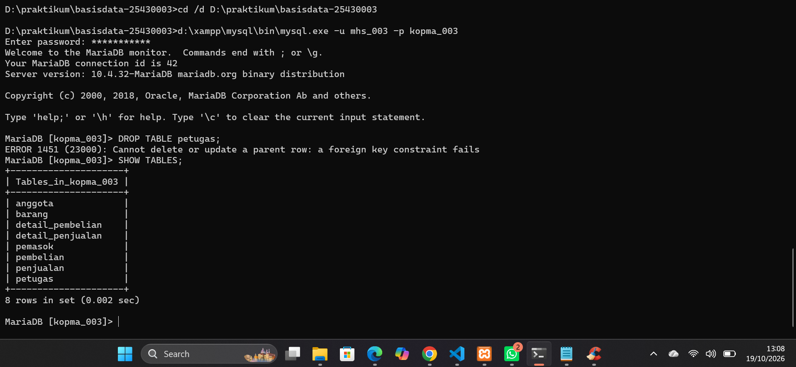

*Gambar 4.1 `DROP TABLE petugas` ditolak dengan ERROR 1451 karena masih dirujuk oleh `penjualan`.*

## 5. Hasil Latihan dan Modifikasi

**Latihan E1 — CHECK untuk `stok_min_barang`**

```sql
ALTER TABLE barang
  ADD CONSTRAINT ck_barang_stok_min CHECK (stok_min_barang >= 0);

UPDATE barang SET stok_min_barang = -1 WHERE id_barang = 1;
-- ERROR 4025 (23000): CONSTRAINT `ck_barang_stok_min` failed for `kopma_003`.`barang`
```

Batas minimum stok dipakai untuk memicu pemesanan ulang (AB-06). Nilai negatif tidak masuk akal, karena stok tidak akan pernah lebih kecil dari batas itu sehingga pemesanan tidak pernah dipicu. Karena itu server sekarang menolaknya.

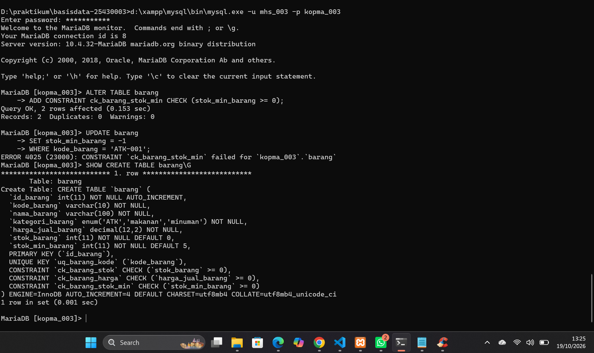

*Gambar 5.1 Constraint `ck_barang_stok_min` ditambahkan, UPDATE `stok_min_barang = -1` ditolak dengan ERROR 4025, dan constraint terlihat di `SHOW CREATE TABLE barang`.*

**Latihan E2 — `ON DELETE SET NULL` pada `fk_penjualan_anggota`**

```sql
ALTER TABLE penjualan DROP FOREIGN KEY fk_penjualan_anggota;
ALTER TABLE penjualan ADD CONSTRAINT fk_penjualan_anggota
  FOREIGN KEY (id_anggota) REFERENCES anggota (id_anggota) ON DELETE SET NULL;
SHOW CREATE TABLE penjualan;
```

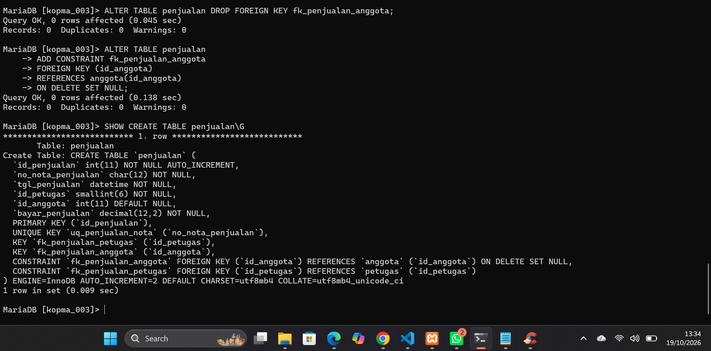

*Gambar 5.2 `fk_penjualan_anggota` lama dihapus lalu dibuat ulang dengan `ON DELETE SET NULL`.*

*Gambar 5.2 menunjukkan `SHOW CREATE TABLE penjualan` yang memuat `ON DELETE SET NULL` pada `fk_penjualan_anggota`.*

Perilakunya diuji di dalam transaksi: anggota `A-9001` yang memiliki nota dihapus, lalu `id_anggota` pada nota tersebut otomatis berubah menjadi NULL. Setelah itu `ROLLBACK` dijalankan, sehingga data uji tidak tersimpan.

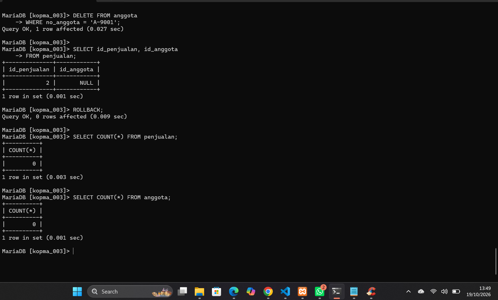

*Gambar 5.3 Setelah anggota dihapus, `id_anggota` pada penjualan menjadi NULL. ROLLBACK mengembalikan basis data ke keadaan kosong.*

Diskusi:
- **Dari sisi AB-02**, perubahan ini secara struktur sah, karena `id_anggota` memang boleh NULL untuk pembeli umum. Namun, maknanya bergeser. Nota lama yang dulu mendapat diskon anggota akan tampak seperti nota pembeli umum, sehingga riwayat diskon tidak lagi bisa ditelusuri.
- **Dari sisi UU PDP**, penghapusan memenuhi hak subjek data untuk meminta datanya dihapus, dan SET NULL mencegah penghapusan itu ditolak oleh kunci tamu. Kekurangannya, nota lama tetap ada tetapi kehilangan pemiliknya.
- **Kesimpulan:** untuk Kopma, cara yang lebih tepat adalah menonaktifkan anggota dan mengosongkan data pribadinya (misalnya `no_hp_anggota`), bukan menghapus barisnya. Dengan begitu, riwayat transaksi tetap utuh dan data pribadi tetap terlindungi.

## 6. Tugas Mandiri: Milestone Proyek 05

### 6.1 Berkas yang Dikumpulkan

| Berkas | Isi |
|---|---|
| `p05_ddl_25430003.sql` | DDL 8 tabel proyek `perpus_003` yang dapat dijalankan ulang dari basis data kosong |
| `p05_uji_constraint_25430003.sql` | Skrip pembuktian constraint (8 uji negatif dan 1 uji positif) |
| `p05_erd_fisik_25430003.png` dan `.drawio` | ERD fisik beserta file sumbernya |
| `p05_dokumentasi_ddl_25430003.md` | Pemetaan tipe data, kaitan constraint dengan AB, dan perbandingan dengan Designer |

### 6.2 Struktur Tabel

Proyek Perpustakaan Cendekia RH terdiri atas 8 tabel. Urutan pembuatannya: `kategori`, `penerbit`, `anggota`, `petugas`, `buku`, `eksemplar`, `peminjaman`, `detail_peminjaman`. Penghapusan dilakukan dengan urutan sebaliknya. DDL dijalankan dua kali berturut-turut sebagai `dev_003` tanpa galat.

| Jenis | Tabel | Satu baris mewakili |
|---|---|---|
| Master | `kategori` | satu kategori buku |
| Master | `penerbit` | satu penerbit |
| Master | `anggota` | satu siswa atau guru anggota perpustakaan |
| Master | `petugas` | satu petugas perpustakaan |
| Master | `buku` | satu judul buku |
| Master | `eksemplar` | satu buku fisik dari sebuah judul |
| Kepala transaksi | `peminjaman` | satu slip peminjaman |
| Detail transaksi | `detail_peminjaman` | satu eksemplar di dalam satu slip, termasuk pengembalian dan dendanya |

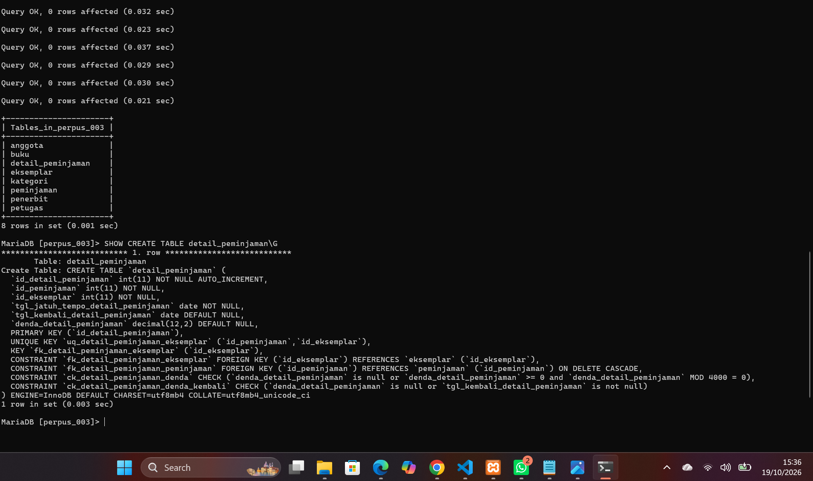

*Gambar 6.1 Struktur tabel `detail_peminjaman` hasil DDL proyek, dijalankan sebagai `dev_003`.*

### 6.3 Keputusan Desain dari ERD ke Desain Fisik

1. **Kunci pengganti.** Primary key setiap tabel berupa `id_*` INT AUTO_INCREMENT. Kode alami seperti AG-001, BK-001, EK-001, dan PJ-001 disimpan di kolom `kode_*` atau `no_peminjaman` yang diberi UNIQUE. Pola ini mengikuti skema kanonik Kopma, sehingga kode tetap unik dan formatnya bisa diubah tanpa merusak relasi.
2. **Nama kolom.** Semua kolom diberi akhiran nama tabel sesuai standar penamaan, misalnya `alamat` menjadi `alamat_anggota` dan `denda` menjadi `denda_detail_peminjaman`.
3. **Tabel `kategori`.** Entitas `kategori_buku` di ERD dibuat sebagai tabel `kategori`, supaya primary key-nya tetap `id_kategori` seperti di kamus data.
4. **Kunci kandidat detail.** `id_detail_peminjaman` menjadi primary key, sedangkan pasangan `(id_peminjaman, id_eksemplar)` dijaga UNIQUE sesuai hasil normalisasi P04.

### 6.4 Pemetaan Tipe Data (ringkas)

| Kolom | Tipe | Alasan |
|---|---|---|
| `id_petugas`, `id_kategori` | SMALLINT | Jumlah datanya sedikit. FK yang merujuknya harus bertipe sama persis |
| `id_*` lainnya | INT | Volume diperkirakan 60 transaksi per hari |
| `isbn_buku` | CHAR(13) NULL | ISBN-13 panjangnya tetap dan boleh kosong |
| `tahun_terbit_buku` | YEAR | Otomatis menolak tahun yang tidak valid |
| Tanggal transaksi | DATE | Keterlambatan dihitung per hari, jadi jam tidak diperlukan |
| `denda_detail_peminjaman` | DECIMAL(12,2) NULL | Uang harus tepat. NULL selama buku belum dikembalikan |
| Status dan kondisi | ENUM | Nilainya terbatas (AB-07, AB-11) |

Tabel lengkapnya ada di `p05_dokumentasi_ddl_25430003.md` bagian 2.

### 6.5 Constraint dan Kaitannya dengan Aturan Bisnis

| Constraint | Aturan |
|---|---|
| `uq_anggota_kode` | AB-01 |
| `uq_buku_kode`, `uq_eksemplar_kode`, `uq_eksemplar_inventaris` | AB-02 |
| `fk_eksemplar_buku` | AB-03 |
| `uq_peminjaman_no`, `fk_peminjaman_anggota`, `fk_peminjaman_petugas` | AB-04 |
| `ck_eksemplar_rusak` | AB-05, AB-07 |
| `ck_detail_peminjaman_denda` (berbasis P = 4) | AB-08 |
| `ck_detail_peminjaman_denda_kembali` | AB-09 |
| `fk_buku_kategori`, `fk_buku_penerbit` | AB-10 |
| ENUM `status_anggota` | AB-11 |

**CHECK berbasis parameter P.** P = (03 mod 9) + 1 = 4, sehingga denda adalah Rp4.000 per eksemplar per hari (AB-08). Denda yang benar selalu kelipatan 4.000, dan aturan ini dijaga oleh `CHECK (denda_detail_peminjaman >= 0 AND MOD(denda_detail_peminjaman, 4000) = 0)`.

**Batas P + 2.** Batas maksimal 6 eksemplar per peminjaman (AB-05) menyangkut **jumlah baris** di `detail_peminjaman`. CHECK hanya memeriksa satu baris, jadi aturan ini tidak bisa dijaga oleh CHECK dan ditandai untuk Modul 14. Aturan lain yang juga ditunda: AB-06 (jatuh tempo = tanggal pinjam + 7 hari) dan AB-11 (hanya anggota aktif yang boleh meminjam), karena keduanya melibatkan tabel lain.

**Aksi ON DELETE.** Hanya `fk_detail_peminjaman_peminjaman` yang memakai `ON DELETE CASCADE`, karena rincian tidak ada artinya tanpa slipnya. FK lainnya memakai RESTRICT (bawaan), karena riwayat transaksi disimpan 5 tahun (P02 bagian 9.3). Anggota, petugas, buku, dan eksemplar yang sudah punya riwayat tidak boleh dihapus.

### 6.6 Pembuktian Constraint

| Uji | Data salah | Hasil | Aturan |
|---|---|---|---|
| U1 | Eksemplar dengan `id_buku` 99 | ERROR 1452 | AB-03 |
| U2 | Kode anggota AG-001 kembar | ERROR 1062 | AB-01 |
| U3 | EK-001 dua kali dalam PJ-001 | ERROR 1062 | Kunci kandidat P04 |
| U4 | Eksemplar rusak berstatus dipinjam | ERROR 4025 | AB-05, AB-07 |
| U5 | Denda Rp5.000 | ERROR 4025 | AB-08 |
| U6 | Denda diisi sebelum buku kembali | ERROR 4025 | AB-09 |
| U7 | `status_anggota = 'cuti'` | ERROR 1265 | AB-11 |
| U8 | Menghapus anggota yang punya riwayat | ERROR 1451 | Retensi riwayat |
| Positif | EK-005 terlambat 2 hari, denda Rp8.000 | Diterima | AB-08 |

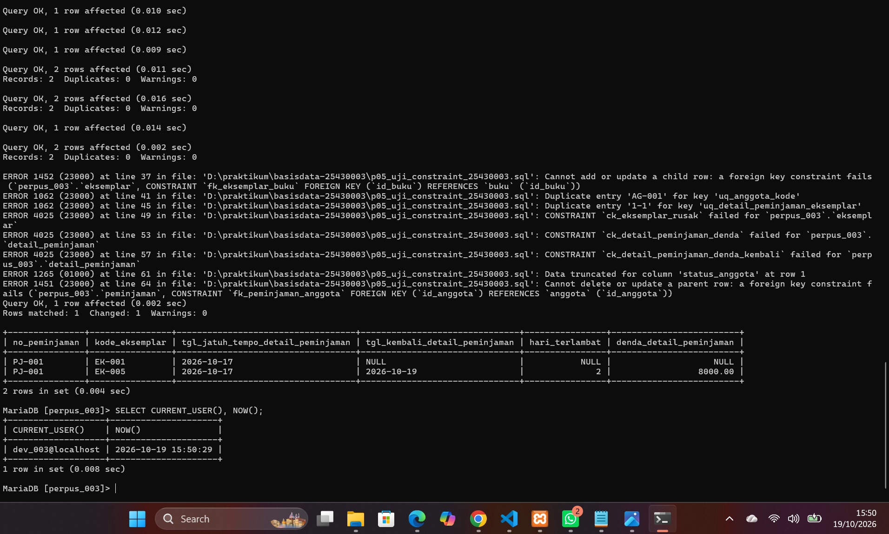

*Gambar 6.2 Delapan perintah salah ditolak server, sedangkan denda Rp8.000 untuk 2 hari keterlambatan diterima. `CURRENT_USER()` menunjukkan `dev_003@localhost`.*

### 6.7 ERD Fisik


*Gambar 6.3 ERD fisik Perpustakaan Cendekia RH. Tipe data dan constraint sama persis dengan skrip DDL.*

### 6.8 Perbandingan Designer dengan ERD

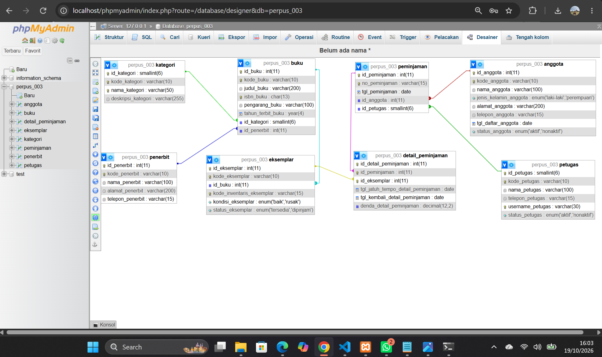

*Gambar 6.4 Tampilan Designer phpMyAdmin untuk basis data `perpus_003`.*

| Aspek | ERD | Designer | Hasil |
|---|---|---|---|
| Jumlah tabel | 8 | 8 | Sama |
| Relasi | 7 | 7 garis FK | Sama |
| Tipe data dan ENUM | Dicantumkan | Terlihat | Sama |
| Kardinalitas | Crow's Foot | Hanya garis FK | Berbeda tampilan |
| CHECK, DEFAULT, UNIQUE | Dicantumkan | Tidak terlihat | Berbeda tampilan |
| Data pribadi | Ditandai 🔒 | Tidak ada penanda | Berbeda tampilan |

Perbedaan yang ditemukan hanya soal cara tampilan, bukan isi. Designer tidak menggambar kardinalitas dan tidak menampilkan CHECK atau UNIQUE, tetapi constraint tersebut terbukti ada melalui `SHOW CREATE TABLE` (Gambar 6.1) dan uji pada bagian 6.6.

## 7. Pembahasan dan Kendala

1. **Warning saat DDL pertama kali dijalankan.** Pada run pertama, setiap `DROP TABLE IF EXISTS` menghasilkan `1 warning`, karena tabel yang akan dihapus belum ada. Ini bukan galat. `IF EXISTS` membuat server cukup memberi peringatan, bukan menghentikan skrip. Pada run kedua tidak ada warning, dan itu membuktikan skrip dapat dijalankan ulang.
2. **Penamaan kolom.** Di ERD konseptual, sebagian atribut belum diberi akhiran nama tabel (misalnya `alamat`, `denda`). Saat membuat DDL, semua kolom disesuaikan dengan standar `<atribut>_<nama_tabel>` supaya asal kolom langsung terlihat ketika tabel digabungkan.
3. **Aturan yang tidak bisa dijaga CHECK.** Batas 6 eksemplar per peminjaman awalnya ingin dijaga dengan CHECK. Ternyata CHECK hanya memeriksa satu baris, sedangkan aturan ini menghitung banyak baris detail. Karena itu, aturan ini ditunda ke Modul 14.
4. **Tipe kunci tamu.** Kolom FK harus bertipe sama persis dengan kolom induk. Contohnya, `peminjaman.id_petugas` harus SMALLINT karena `petugas.id_petugas` bertipe SMALLINT. Jika tipenya berbeda, MariaDB menolak dengan ERROR 1005 errno 150.
5. **Perintah SQL diketik di Command Prompt.** Setelah menjalankan `mysql ... < p05_ddl_kopma_25430003.sql`, perintah `SHOW CREATE TABLE` dan `SELECT` sempat diketik langsung di Command Prompt sehingga muncul pesan `'SHOW' is not recognized as an internal or external command`. Penyebabnya, mode `<` hanya menjalankan berkas lalu langsung keluar dari klien. Solusinya, masuk dulu ke klien dengan `mysql -u mhs_003 -p kopma_003` sampai muncul prompt `MariaDB [kopma_003]>`.
6. **Berkas tidak ikut ter-commit.** Perintah `git add` sempat terpotong menjadi beberapa baris, sehingga baris berikutnya dianggap perintah Windows dan hanya dua berkas SQL yang ter-commit. Hal ini terlihat dari keluaran `2 files changed`. Solusinya, jalankan `git add` lagi untuk berkas yang tertinggal, lalu commit ulang.
7. **Skrip uji hanya bisa dijalankan sekali.** Kalau skrip uji dijalankan dua kali, data contohnya sendiri ditolak (ERROR 1062) karena sudah ada. Solusinya, jalankan dulu DDL untuk mengosongkan tabel sebelum menguji ulang.

## 8. Kesimpulan

Skema 3NF Perpustakaan Cendekia RH berhasil diwujudkan menjadi 8 tabel di `perpus_003`, dengan skrip yang dapat dijalankan ulang dari basis data kosong. Aturan bisnis yang menyangkut satu baris berhasil dijaga server melalui PRIMARY KEY, FOREIGN KEY, UNIQUE, ENUM, dan CHECK, termasuk CHECK denda berbasis parameter P = 4, dan hal ini terbukti dari 8 perintah salah yang ditolak. Aturan yang melibatkan banyak baris atau tabel lain, seperti batas 6 eksemplar per peminjaman, belum bisa dijaga constraint dan akan diselesaikan dengan transaksi di Modul 14.

## 9. Pernyataan Penggunaan AI

| Alat | Untuk apa | Bagian yang terbantu |
|---|---|---|
| Claude (Anthropic) | Panduan langkah instalasi dan praktikum, menyusun draf DDL proyek dari dokumen P02 dan P04, skrip uji constraint, ERD fisik, dokumentasi tipe data, serta draf laporan | Bagian 2–8 laporan dan berkas `p05_ddl_25430003.sql`, `p05_uji_constraint_25430003.sql`, `p05_erd_fisik_25430003`, `p05_dokumentasi_ddl_25430003.md` |

Seluruh skrip sudah saya jalankan sendiri di XAMPP, tangkapan layar diambil dari komputer saya, dan setiap keputusan desain sudah saya pelajari untuk dijelaskan saat viva.

## 10. Bukti Git

- Repositori: https://github.com/rizalhafiz808/basisdata-25430003

| Hash | Pesan commit | Isi |
|---|---|---|
| `3b4b4fb` | `p05: ddl kopma` | Skrip DDL Kopma (langkah D) |
| `30d0054` | `p05: erd fisik, latihan E, bukti rerun` | ERD fisik Kopma, hasil latihan E1–E2, dan bukti skrip dapat dijalankan ulang |
| `527fdfb` | `p05: milestone proyek 5 ddl dan erd fisik` | Skrip DDL dan uji constraint proyek `perpus_003` |
| `46ac386` | `p05: erd fisik, dokumentasi, dan laporan` | ERD fisik proyek `perpus_003` (`p05_erd_fisik_25430003.drawio` dan `.png`) |
| `21eaecc` | `p05: erd fisik, dokumentasi, dan laporan` | Dokumentasi DDL, laporan P05, dan tangkapan layar proyek |

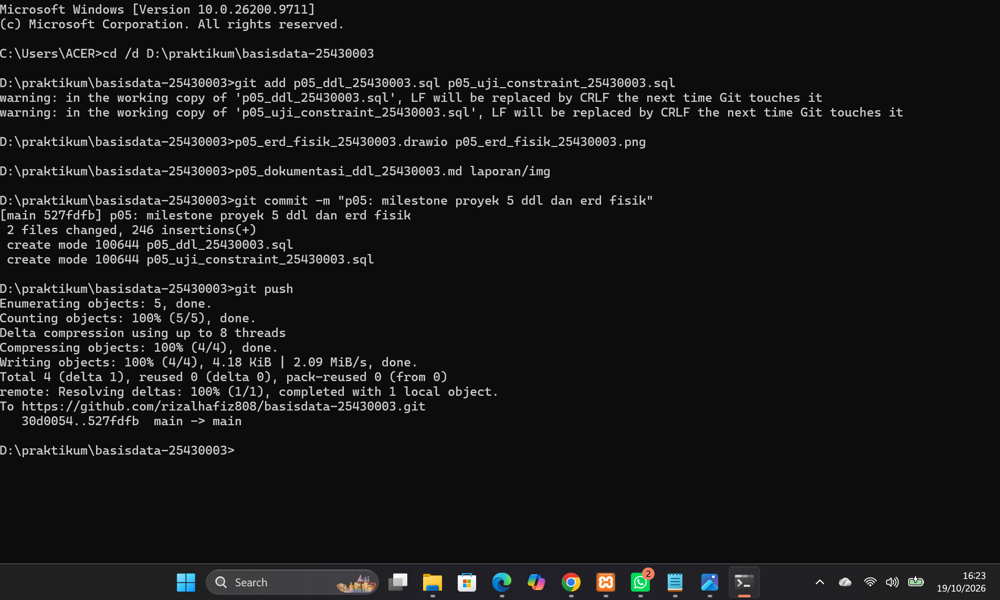

*Gambar 10.1 Push commit `527fdfb` ke `github.com/rizalhafiz808/basisdata-25430003` berhasil.*`

## Checklist

### Checklist Umum

| Status | Butir | Yang harus ada |
|---|---|---|
| ☑ | Identitas | Nama, NIM, kelas, pertemuan ke-5, tanggal, nama asisten/dosen |
| ☑ | Tujuan | Ditulis ulang dengan bahasa sendiri |
| ☑ | Ringkasan teori | Maksimal setengah halaman |
| ☑ | Langkah percobaan (D) | Tangkapan layar dengan keterangan |
| ☑ | Titik Analisis | Semua dijawab beserta alasan |
| ☑ | Latihan (E) | Skrip dan bukti berjalan |
| ☑ | Tugas Mandiri (F) | Berkas, bukti, dan penjelasan keputusan desain |
| ☑ | Pembahasan dan kendala | Galat, cara membaca, dan cara mengatasi |
| ☑ | Kesimpulan | 2–4 kalimat |
| ☑ | Pernyataan Penggunaan AI | Alat, tujuan, dan bagian yang dibantu |
| ☑ | Bukti Git | Tautan repositori dan hash commit |
| ☑ | Keaslian | Tangkapan layar memperlihatkan akun dan jam sistem |
| ☑ | Berkas wajib P05 | `p05_ddl_25430003.sql` (dapat dijalankan ulang) dan ERD fisik `p05_erd_fisik_25430003` |
| ☑ | Bukti tangkapan layar P05 | `SHOW CREATE TABLE` tabel utama; galat saat constraint dilanggar (FK, UNIQUE, CHECK) |
| ☑ | Analisis wajib P05 | Alasan pemilihan tipe data dan constraint; kaitan constraint dengan AB-xx |

### Tabel 5.5 Checklist khusus laporan Pertemuan 5

| Status | Jenis | Yang harus ada |
|---|---|---|
| ☑️ | Berkas wajib | `p05_ddl_<NIM>.sql` (dapat dijalankan ulang dari basis data kosong) dan ERD fisik `p05_erd_fisik_<NIM>` |
| ☑️ | Bukti tangkapan layar | `SHOW CREATE TABLE` tabel utama; gagal saat constraint dilanggar (FK, UNIQUE, CHECK) |
| ☑️ | Analisis wajib | Alasan pemilihan tipe data dan constraint; kaitan constraint dengan AB-xx |