# Laporan Praktikum Basis Data - Pertemuan 06

**Nama:** Rizal Hafiz

**NIM:** 25430003

**Kelas:** A

**Pertemuan:** 6

**Dosen/Asisten:** Dedi Irawan, S.Kom., M.T.I.

**Tanggal:** 1 November 2026

## 1. Tujuan Praktikum

1. Mengisi data ke dalam tabel menggunakan `INSERT` satu baris, banyak baris sekaligus, dan `INSERT ... SELECT`.
2. Mengubah dan menghapus data dengan lebih aman memakai mode `sql_safe_updates`.
3. Membuat skenario uji positif dan negatif, lalu mencatat hasil yang muncul di layar.
4. Menyiapkan data sampel proyek yang bisa dibuat ulang dari skrip.

## 2. Ringkasan Dasar Teori

DML (Data Manipulation Language) adalah perintah untuk mengolah isi tabel, yaitu `INSERT`, `UPDATE`, `DELETE`, dan `SELECT`. Karena tabel saling terhubung lewat kunci tamu, data harus diisi mulai dari tabel induk dulu, baru tabel anak. Kalau menghapus, urutannya kebalikannya, kecuali relasi yang sudah diberi `ON DELETE CASCADE`.

Hal yang perlu diwaspadai adalah `UPDATE` atau `DELETE` tanpa `WHERE`, karena perintah itu akan mengenai semua baris tanpa ada pesan galat. Untuk mencegahnya bisa dipakai `sql_safe_updates`. Kalau mode ini aktif, server akan menolak perintah yang `WHERE`-nya tidak memakai kolom kunci atau tidak ada `LIMIT`, dengan ERROR 1175.

Menurut saya, membuat tabel saja belum cukup, karena tabel itu juga harus diuji. Ada uji positif (data yang benar harus diterima) dan uji negatif (data yang salah harus ditolak). Setiap uji saya catat masukannya, hasil yang diharapkan, hasil yang muncul di layar, dan statusnya. Kalau ada uji yang gagal, artinya ada aturan bisnis yang belum dijaga oleh server.

## 3. Hasil Langkah Percobaan

Semua langkah percobaan saya kerjakan di basis data `kopma_003` dengan akun `mhs_003`. Sebelum mulai, saya membangun ulang tabel dari `p05_ddl_kopma_25430003.sql`, lalu mengisinya dengan `p06_data_kopma_25430003.sql`.

### 3.1 Mengisi Data Induk (D.1)

Saya mengisi data induk dengan satu perintah `INSERT` untuk banyak baris sekaligus. Isinya 5 petugas (K01 Dimas, K02 Sari, K03 Rina, G01 Joko, dan P01 Ketua Kopma), 4 barang, 3 anggota dengan A-0312 berstatus nonaktif, dan 2 pemasok. Stok Roti Cokelat hanya 6, padahal batas minimumnya 10, jadi saya juga menambahkan satu pesanan pembelian FK-SJ-0925-01 dengan status `dipesan` sesuai AB-06.

### 3.2 Mencatat Nota Penjualan (D.2)

Setelah itu saya mencatat nota PJ-2609-0142 dari Modul 2, dengan kasir Rina dan anggota A-0457. Tiga barang di nota ini saya masukkan dengan `INSERT ... SELECT`, sehingga harga satuannya langsung diambil dari `harga_jual_barang` saat itu (AB-04). Setelah itu stok setiap barang saya kurangi sesuai jumlah yang dibeli. Untuk kunci tamu, saya tidak menebak angka `id`, tetapi mengambilnya dari kode seperti `kode_petugas`, `no_anggota`, dan `kode_barang`.

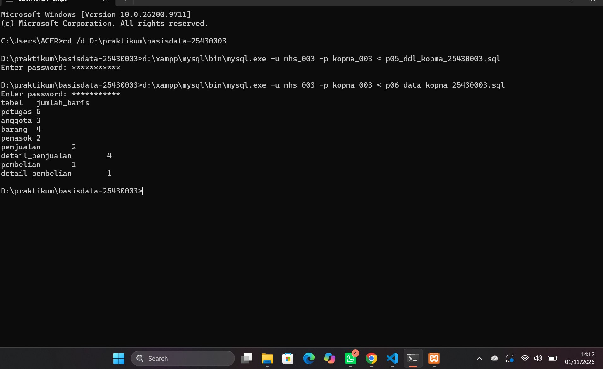

*Gambar 3.1 Jumlah baris setelah data Kopma diisi: petugas 5, anggota 3, barang 4, pemasok 2, penjualan 2, detail_penjualan 4, pembelian 1, detail_pembelian 1.*

### 3.3 Mengubah dan Menghapus dengan Aman (D.3)

Saya menyalakan mode aman dengan `SET SESSION sql_safe_updates = 1`, lalu mencoba menaikkan harga tanpa `WHERE`. Hasilnya ditolak dengan ERROR 1175. Setelah saya tambahkan `WHERE kategori_barang = 'ATK' AND id_barang > 0`, perintahnya berhasil. Harga ATK-001 naik menjadi Rp4.400 dan ATK-002 menjadi Rp7.150, tetapi harga di nota PJ-2609-0142 tetap Rp4.000 dan Rp6.500.

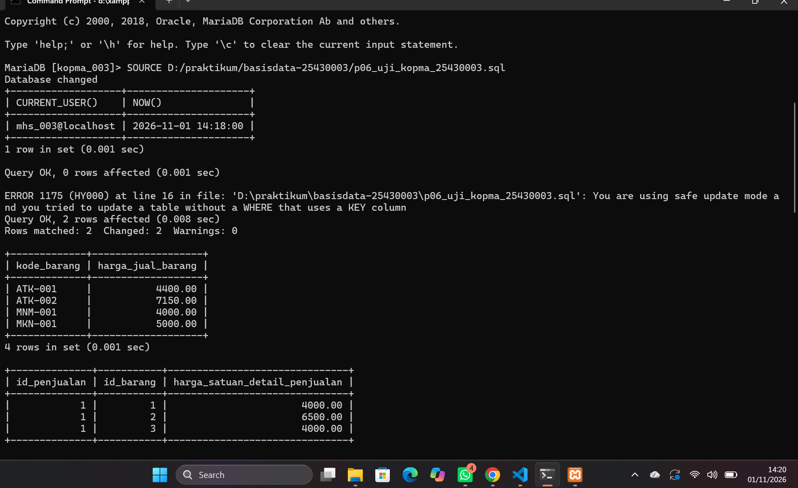

*Gambar 3.2 Login sebagai `mhs_003@localhost`. UPDATE tanpa WHERE ditolak dengan ERROR 1175, sedangkan UPDATE dengan WHERE berhasil dan harga di nota lama tidak ikut berubah.*

Berikutnya saya menghapus nota uji PJ-2609-0143. Jumlah detailnya berubah dari 1 menjadi 0 karena relasinya memakai `ON DELETE CASCADE`. Tetapi waktu saya mencoba menghapus petugas K03, server menolak dengan ERROR 1451, karena Rina pernah melayani nota PJ-2609-0142.

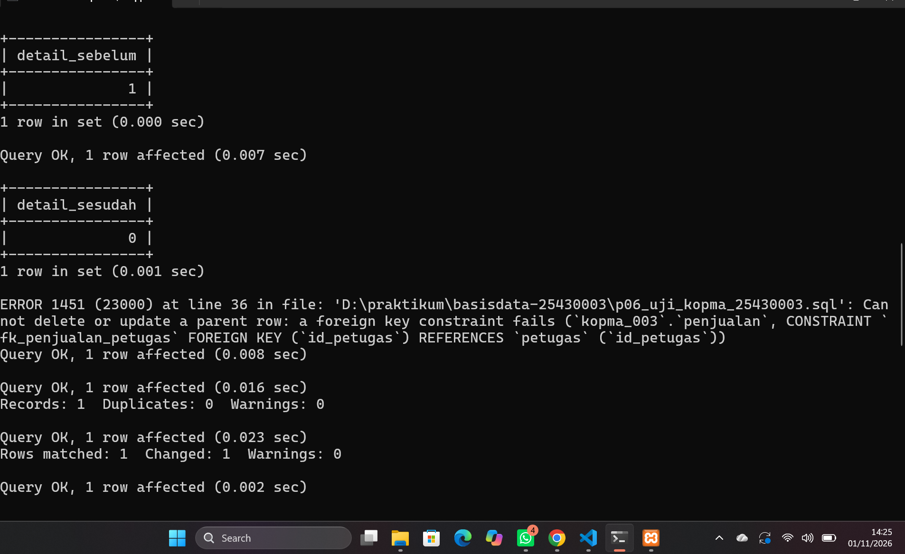

*Gambar 3.3 Detail nota ikut terhapus (1 menjadi 0), sedangkan penghapusan petugas K03 ditolak dengan ERROR 1451.*

### 3.4 Skenario Uji (D.4)

Skenario uji lengkapnya saya tulis di berkas `p06_uji_kopma_25430003.md`. Ringkasannya sebagai berikut.

| Kode | Masukan | Harapan | Hasil nyata | Status | Aturan |
|---|---|---|---|---|---|
| UJ-01 | Nota PJ-2609-0144 dengan anggota aktif A-0458 | Diterima | Query OK | LULUS | AB-02 |
| UJ-02 | Nota PJ-2609-0145 pembeli umum | Diterima, `id_anggota` NULL | Query OK, NULL | LULUS | AB-02 |
| UJ-03 | Stok diubah menjadi -5 | Ditolak, ERROR 4025 | ERROR 4025 `ck_barang_stok` | LULUS | AB-03 |
| UJ-04 | Nomor nota PJ-2609-0142 kembar | Ditolak, ERROR 1062 | ERROR 1062 `uq_penjualan_nota` | LULUS | AB-01 |
| UJ-05 | Detail dengan qty 0 | Ditolak, ERROR 4025 | ERROR 4025 `ck_detail_qty` | LULUS | `ck_detail_qty` |
| UJ-06 | Anggota dengan NIM kembar | Ditolak, ERROR 1062 | ERROR 1062 `uq_anggota_nim` | LULUS | AB-05 |
| UJ-07 | Nota oleh petugas 99 | Ditolak, ERROR 1452 | ERROR 1452 `fk_penjualan_petugas` | LULUS | `fk_penjualan_petugas` |
| UJ-08 | UPDATE tanpa WHERE di mode aman | Ditolak, ERROR 1175 | ERROR 1175 | LULUS | Kebijakan lab |
| UJ-09 | Detail qty 50, padahal stok hanya 6 | Ditolak | Diterima | GAGAL | AB-03 |

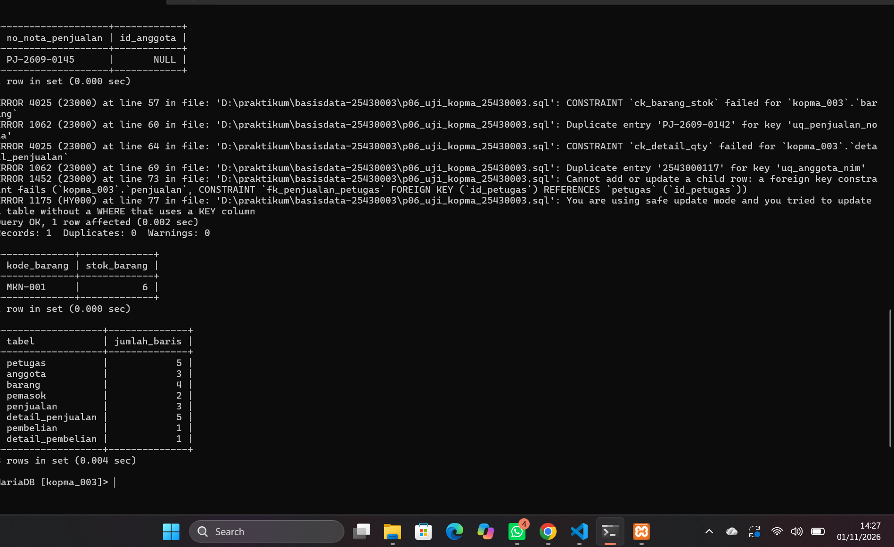

*Gambar 3.4 Hasil UJ-01 sampai UJ-09 dan jumlah baris setelah pengujian.*

Setelah itu saya menjalankan ulang semua skrip dari awal, yaitu DDL Modul 5 lalu data Modul 6, dan jumlah barisnya tetap sama.

## 4. Jawaban Titik Analisis

**Titik Analisis 1**

Menurut saya, `INSERT ... SELECT` lebih aman karena harganya langsung diambil dari kolom `harga_jual_barang`. Jadi tidak ada kemungkinan salah ketik, dan harga di nota pasti sama dengan harga yang berlaku saat itu. Kalau angka 4000 diketik manual, kasir bisa saja salah memasukkan angka, dan server tidak akan tahu kalau angkanya salah.

Waktu percobaan, harga pulpen saya naikkan menjadi Rp4.400, dan nota PJ-2609-0142 tidak ikut berubah. Ini terjadi karena harga Rp4.000 sudah tersimpan di `harga_satuan_detail_penjualan` saat nota dicatat, sesuai AB-04. Buktinya bisa dilihat di Gambar 3.2.

**Titik Analisis 2**

Nota yang dihapus ikut menghapus detailnya karena di Modul 5 `fk_detail_penjualan` saya beri `ON DELETE CASCADE`. Detail adalah bagian dari nota, jadi kalau notanya tidak ada, detailnya juga tidak ada gunanya. Sedangkan `fk_penjualan_petugas` tidak saya beri aksi apa pun, sehingga yang berlaku adalah aturan bawaan RESTRICT. Karena itu server menolak penghapusan petugas yang masih tercatat di nota (ERROR 1451). Riwayat penjualan tetap harus mencatat siapa kasir yang melayani.

Kalau ada kasir yang berhenti bekerja, menurut saya datanya tidak boleh dihapus. Yang lebih tepat adalah mengunci akun MariaDB-nya dan mencabut hak aksesnya (dibahas di Pertemuan 13), sehingga datanya tetap ada sebagai riwayat. Tabel `petugas` di Kopma saya belum punya kolom status, jadi nanti bisa ditambahkan kolom seperti `status_petugas` supaya petugas yang sudah berhenti bisa ditandai.

**Titik Analisis 3**

Uji yang saya perkirakan gagal adalah UJ-09, yaitu menjual Roti Cokelat sebanyak 50 padahal stoknya hanya 6. Ternyata memang gagal, karena perintahnya diterima server dan stok tetap 6.

Hal ini terjadi karena CHECK hanya memeriksa baris di tabelnya sendiri pada saat baris itu diubah. Waktu detail dicatat, tabel yang berubah adalah `detail_penjualan`, bukan `barang`, jadi `ck_barang_stok` tidak ikut dicek. Membandingkan qty dengan stok berarti melibatkan dua tabel, dan CHECK tidak bisa melakukan itu. Rencananya aturan ini akan saya jaga dengan transaksi di Modul 14, yaitu stok dikurangi di transaksi yang sama dengan pencatatan detail, lalu di-`ROLLBACK` kalau pengurangan stok ditolak oleh CHECK.

## 5. Hasil Latihan dan Modifikasi

**Latihan E1 — Arsip anggota nonaktif sebelum 2025**

```sql
CREATE TABLE anggota_arsip LIKE anggota;

INSERT INTO anggota_arsip
SELECT a.* FROM anggota a
WHERE a.status_anggota = 'nonaktif'
  AND a.tgl_daftar_anggota < '2025-01-01'
  AND NOT EXISTS (SELECT 1 FROM penjualan p WHERE p.id_anggota = a.id_anggota);

DELETE FROM anggota
WHERE id_anggota IN (SELECT id_anggota FROM anggota_arsip)
LIMIT 100;
```

Hasilnya, anggota A-0312 (Fikri Ramadhan, nonaktif, mendaftar 14 Februari 2024, belum pernah belanja) pindah ke tabel `anggota_arsip`, dan jumlah anggota berkurang dari 3 menjadi 2.

Syarat `NOT EXISTS` ini penting untuk basis data saya. Di Latihan E2 Modul 5, saya mengubah `fk_penjualan_anggota` menjadi `ON DELETE SET NULL`. Akibatnya, kalau anggota yang punya nota dihapus, server tidak menolak, tetapi langsung mengosongkan `id_anggota` di nota lamanya. Kalau tidak pakai `NOT EXISTS`, riwayat belanja anggota bisa hilang tanpa ada pesan galat. Selain itu, mode aman ternyata menolak `DELETE` yang `WHERE`-nya berupa subquery, jadi saya tambahkan `LIMIT` supaya perintahnya bisa jalan.

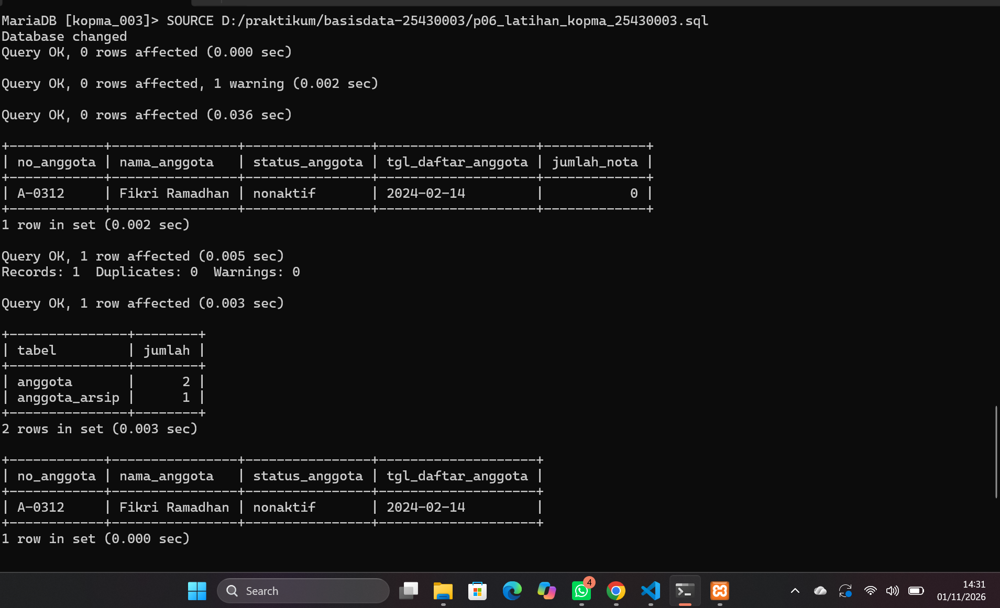

*Gambar 5.1 Anggota nonaktif yang mendaftar sebelum 2025 dipindahkan ke `anggota_arsip`.*

**Latihan E2 — Harga makanan naik 5%, dibulatkan ke ratusan**

```sql
UPDATE barang
SET harga_jual_barang = ROUND(harga_jual_barang * 1.05, -2)
WHERE kategori_barang = 'makanan' AND id_barang > 0;
```

Harga Roti Cokelat naik dari Rp5.000 menjadi Rp5.250, lalu dibulatkan ke ratusan terdekat menjadi Rp5.300. Angka `-2` di `ROUND` artinya pembulatan dilakukan di dua angka sebelum koma, yaitu ratusan.

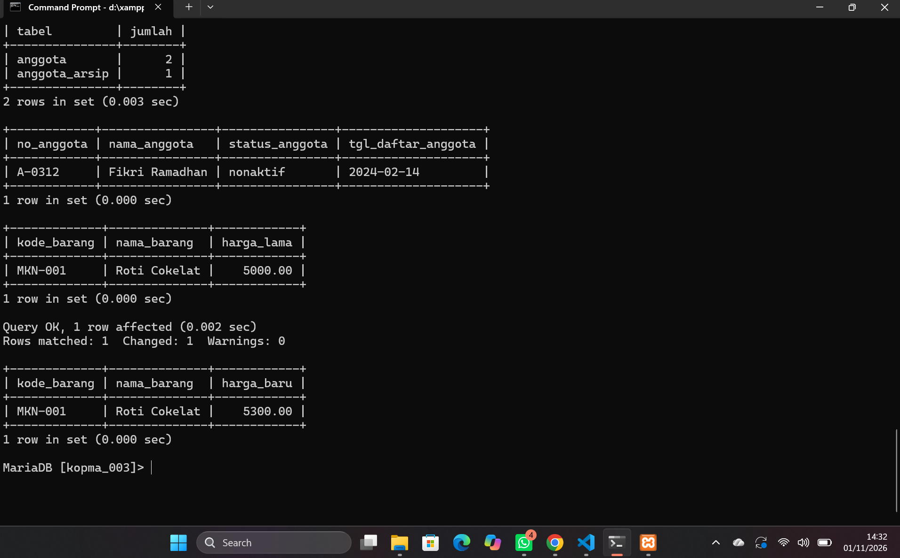

*Gambar 5.2 Harga makanan sebelum dan sesudah naik 5%.*

## 6. Tugas Mandiri: Milestone Proyek 06

### 6.1 Berkas yang Dikumpulkan

| Berkas | Isi |
|---|---|
| `p06_data_25430003.sql` | Data sampel `perpus_003` berdasarkan parameter P, bisa dibuat ulang setelah DDL |
| `p06_uji_25430003.sql` | Skrip 15 skenario uji di dalam transaksi yang diakhiri `ROLLBACK` |
| `p06_uji_25430003.md` | Tabel skenario uji: masukan, hasil yang diharapkan, hasil nyata, dan status |

### 6.2 Data Sampel Berdasarkan Parameter P

Parameter P saya adalah (03 mod 9) + 1 = 4.

| Ketentuan | Rumus | Penerapan |
|---|---|---|
| Tabel induk minimal 5 baris | — | kategori 6, penerbit 6, anggota 12, petugas 5, buku 15, eksemplar 40 |
| Transaksi utama minimal 10 × P | 10 × 4 = 40 | 40 peminjaman dan 76 detail |
| Minimal 3 tanggal berbeda | — | 17 tanggal, 10–30 Oktober 2026 |
| Maks. eksemplar per peminjaman (AB-05) | P + 2 = 6 | Slip paling banyak berisi 6 eksemplar |
| Denda per hari (AB-08) | P × Rp1.000 | 11 eksemplar terlambat, total denda Rp96.000 |

Data ini saya buat supaya mirip kondisi perpustakaan sungguhan dan bisa dipakai untuk kueri di Pertemuan 7 sampai 15:

- PJ-001 sama dengan contoh slip di P02, yaitu EK-005 terlambat 2 hari dengan denda Rp8.000.
- Sampai 31 Oktober 2026 masih ada 27 eksemplar yang dipinjam, dan 3 di antaranya sudah lewat jatuh tempo (untuk KI-03 dan KI-04).
- Ada 2 eksemplar rusak, yaitu EK-021 dan EK-033 (untuk KI-07).
- Ada 2 anggota nonaktif dan 1 petugas nonaktif yang tidak punya transaksi baru, sesuai AB-11.

Saya juga sudah mengecek datanya: tidak ada anggota nonaktif yang meminjam, jatuh tempo selalu 7 hari setelah tanggal pinjam, denda selalu Rp4.000 dikali hari terlambat, status eksemplar sesuai dengan pinjaman yang belum kembali, dan tidak ada eksemplar yang dipinjam dua orang di waktu yang sama. Kunci tamu juga saya isi lewat kode, bukan menebak angka `id`.

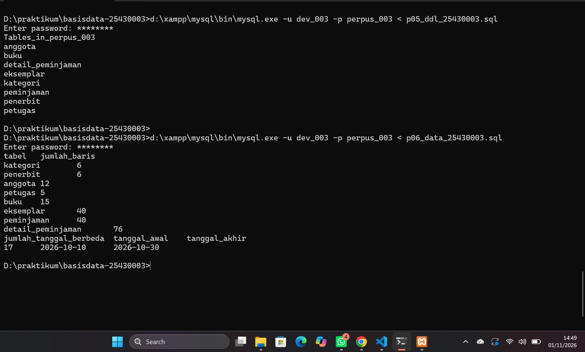

*Gambar 6.1 Jumlah baris setiap tabel `perpus_003` dan 17 tanggal peminjaman, dijalankan dengan akun `dev_003`.*

### 6.3 Skenario Uji Proyek

| Kode | Jenis | Masukan | Harapan | Hasil nyata | Status | Aturan |
|---|---|---|---|---|---|---|
| UJ-01 | Positif | PJ-041 oleh AG-002 (aktif), EK-009 | Diterima | Query OK, EK-009 dipinjam | LULUS | AB-04, AB-06, AB-07 |
| UJ-02 | Positif | EK-009 kembali sebelum jatuh tempo, denda 0 | Diterima | Query OK | LULUS | AB-08, AB-09 |
| UJ-03 | Positif | EK-035 terlambat 3 hari, denda Rp12.000 | Diterima | Query OK, hari_terlambat 3, denda 12000.00 | LULUS | AB-08 |
| UJ-04 | Negatif | Nomor PJ-001 kembar | ERROR 1062 | ERROR 1062 `uq_peminjaman_no` | LULUS | AB-04 |
| UJ-05 | Negatif | Anggota id 999 | ERROR 1452 | ERROR 1452 `fk_peminjaman_anggota` | LULUS | AB-01 |
| UJ-06 | Negatif | Kode inventaris INV-2026-001 kembar | ERROR 1062 | ERROR 1062 `uq_eksemplar_inventaris` | LULUS | AB-02 |
| UJ-07 | Negatif | Buku dengan kategori 99 | ERROR 1452 | ERROR 1452 `fk_buku_kategori` | LULUS | AB-10 |
| UJ-08 | Negatif | Denda Rp6.000 | ERROR 4025 | ERROR 4025 `ck_detail_peminjaman_denda` | LULUS | AB-08 |
| UJ-09 | Negatif | Denda sebelum buku kembali | ERROR 4025 | ERROR 4025 `ck_detail_peminjaman_denda_kembali` | LULUS | AB-09 |
| UJ-10 | Negatif | EK-021 (rusak) dipinjam | ERROR 4025 | ERROR 4025 `ck_eksemplar_rusak` | LULUS | AB-05, AB-07 |
| UJ-11 | Negatif | Status anggota 'cuti' | ERROR 1265 | ERROR 1265 | LULUS | AB-11 |
| UJ-12 | Negatif | Hapus petugas PT-001 | ERROR 1451 | ERROR 1451 `fk_peminjaman_petugas` | LULUS | Retensi riwayat |
| UJ-13 | Negatif | UPDATE tanpa WHERE di mode aman | ERROR 1175 | ERROR 1175 | LULUS | Kebijakan lab |
| UJ-14 | Negatif | Slip PJ-042 berisi 7 eksemplar | Ditolak | Diterima | GAGAL | AB-05 |
| UJ-15 | Negatif | AG-011 (nonaktif) meminjam | Ditolak | Diterima | GAGAL | AB-11 |

Totalnya ada 15 uji, 12 di antaranya uji negatif. Dari 15 uji itu, 13 lulus dan 2 gagal. Semua uji saya jalankan di dalam satu transaksi lalu saya akhiri dengan `ROLLBACK`, sehingga datanya kembali menjadi 40 peminjaman dan 76 detail.

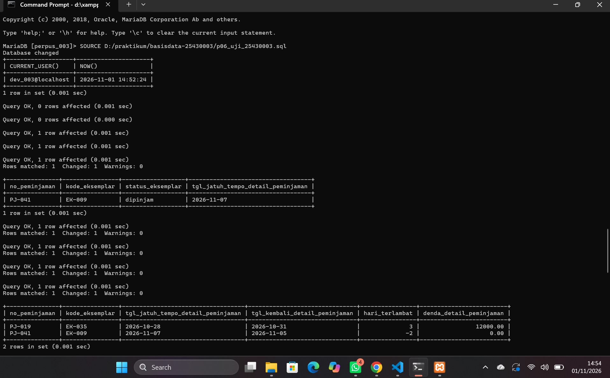

*Gambar 6.2 Login sebagai `dev_003@localhost`. Uji positif UJ-01 sampai UJ-03 diterima, termasuk denda Rp12.000 untuk keterlambatan 3 hari.*

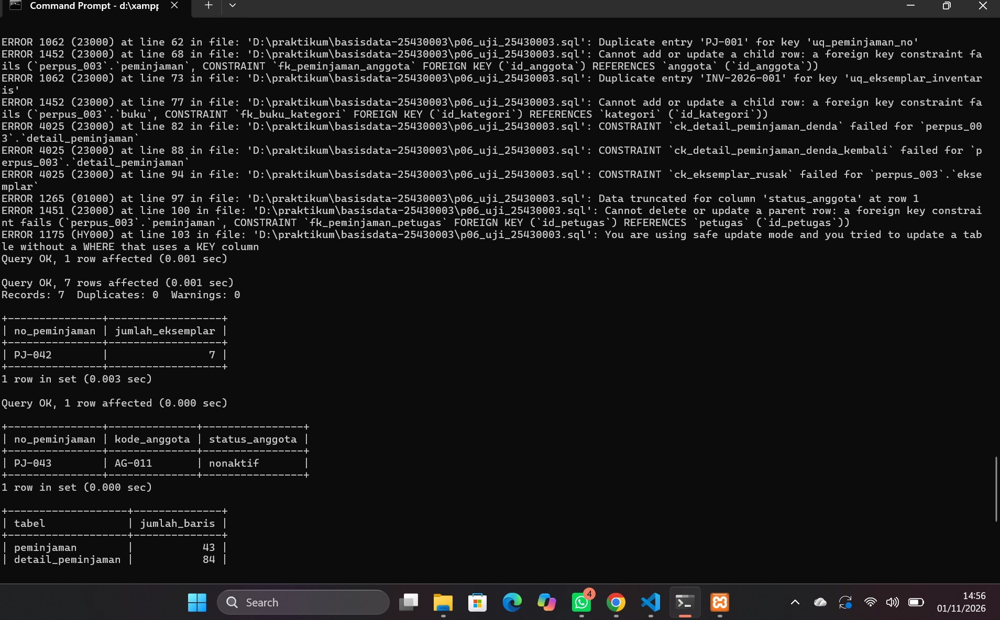

*Gambar 6.3 Sepuluh data yang salah (UJ-04 sampai UJ-13) ditolak server dengan kode galat yang sesuai.*

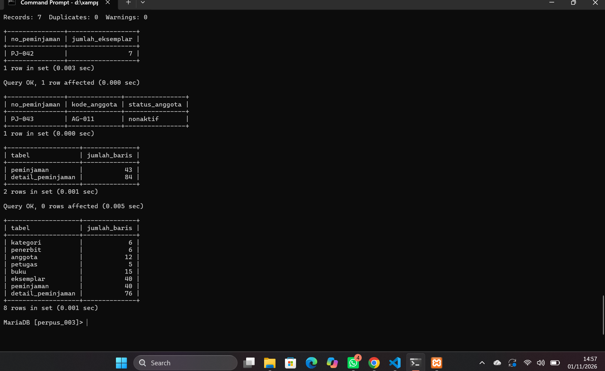

*Gambar 6.4 UJ-14 (7 eksemplar) dan UJ-15 (anggota nonaktif) lolos, lalu setelah ROLLBACK data kembali menjadi 40 peminjaman dan 76 detail.*

### 6.4 Utang Desain untuk Modul 14

| Uji | Aturan | Kenapa belum bisa dijaga | Rencana di Modul 14 |
|---|---|---|---|
| UJ-14 | AB-05 maks. 6 eksemplar (P + 2) | Harus menghitung banyak baris di `detail_peminjaman`, sedangkan CHECK hanya mengecek satu baris | Hitung jumlah detail di dalam transaksi, lalu `ROLLBACK` kalau lebih dari 6 |
| UJ-15 | AB-11 hanya anggota aktif | Status anggota ada di tabel `anggota`, dan CHECK tidak bisa membaca tabel lain | Cek status anggota dulu sebelum peminjaman dicatat |

## 7. Pembahasan dan Kendala

1. **ON DELETE SET NULL di Kopma.** Waktu mengerjakan Latihan E1, saya baru sadar bahwa perubahan `fk_penjualan_anggota` menjadi `ON DELETE SET NULL` di Modul 5 membuat anggota yang punya nota bisa dihapus tanpa ditolak. Karena itu, saya menambahkan syarat `NOT EXISTS` supaya nota lama tidak kehilangan data anggotanya.
2. **ERROR 1175 saat DELETE dengan subquery.** Mode aman menolak `DELETE ... WHERE id_anggota IN (SELECT ...)` karena dianggap tidak memakai kolom kunci secara langsung. Saya mengatasinya dengan menambahkan `LIMIT`, tanpa mematikan mode aman.
3. **Tidak menebak nilai id.** Supaya skrip tetap benar walaupun nilai `AUTO_INCREMENT` berubah, semua kunci tamu saya ambil lewat kode, contohnya `(SELECT id_anggota FROM anggota WHERE kode_anggota = 'AG-002')`.
4. **Skrip uji ikut mengubah data.** Uji positif menambah peminjaman baru, padahal data sampel proyek masih akan dipakai di pertemuan berikutnya. Karena itu, seluruh uji proyek saya bungkus dengan `START TRANSACTION ... ROLLBACK`.

## 8. Kesimpulan

Pada pertemuan ini saya berhasil mengisi basis data Kopma dan proyek `perpus_003` dengan data sampel yang bisa dibuat ulang dari skrip. Data proyek berisi 40 peminjaman sesuai 10 × P dan tersebar di 17 tanggal. Dari 15 uji proyek, 13 lulus dan 2 gagal. Dua uji yang gagal itu (batas 6 eksemplar dan anggota nonaktif) menunjukkan bahwa aturan yang melibatkan banyak baris atau tabel lain belum bisa dijaga oleh constraint, jadi saya catat untuk diselesaikan di Modul 14.

## 9. Pernyataan Penggunaan AI

| Alat | Untuk apa | Bagian yang terbantu |
|---|---|---|
| Claude (Anthropic) | Menyusun skrip data dan uji Kopma, data sampel proyek berdasarkan parameter P, skenario uji proyek, serta draf laporan | Bagian 2–8 laporan dan berkas `p06_data_kopma_25430003.sql`, `p06_uji_kopma_25430003.sql`, `p06_latihan_kopma_25430003.sql`, `p06_data_25430003.sql`, `p06_uji_25430003.sql`, `p06_uji_25430003.md` |

Semua skrip sudah saya jalankan sendiri di XAMPP, hasilnya saya cocokkan dengan yang muncul di layar, dan semua tangkapan layar saya ambil dari komputer saya sendiri.

## 10. Bukti Git

- Repositori: https://github.com/rizalhafiz808/basisdata-25430003

| Hash | Pesan commit | Isi |
|---|---|---|
| `dae7342` | `p06: data dan uji kopma serta proyek` | 17 berkas: skrip data, uji, dan latihan Kopma; data dan uji proyek; dokumen skenario uji; tangkapan layar |
| `c5f0f56` | `p06: laporan pertemuan 6` | Laporan Pertemuan 6 dan tangkapan layar push |


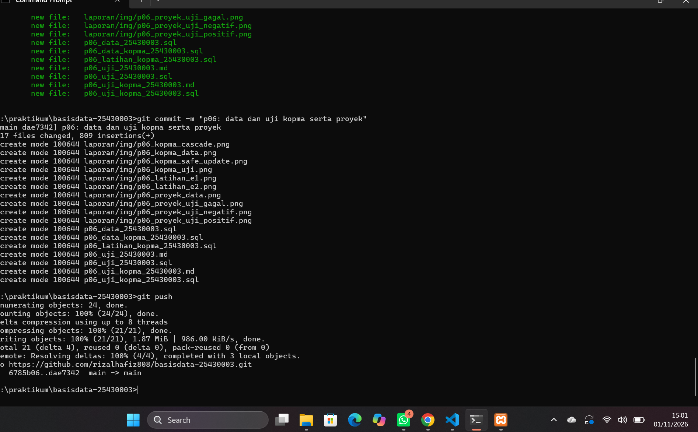

*Gambar 10.1 Push commit `dae7342` (17 berkas) ke `github.com/rizalhafiz808/basisdata-25430003` berhasil.*

## Checklist

### Checklist Umum

| Status | Butir | Yang harus ada |
|---|---|---|
| ☑ | Identitas | Nama, NIM, kelas, pertemuan ke-6, tanggal, nama asisten/dosen |
| ☑ | Tujuan | Ditulis ulang dengan bahasa sendiri |
| ☑ | Ringkasan teori | Maksimal setengah halaman |
| ☑ | Langkah percobaan (D) | Tangkapan layar dengan keterangan |
| ☑ | Titik Analisis | Semua dijawab beserta alasan |
| ☑ | Latihan (E) | Skrip dan bukti berjalan |
| ☑ | Tugas Mandiri (F) | Berkas, bukti, dan penjelasan keputusan desain |
| ☑ | Pembahasan dan kendala | Galat, cara membaca, dan cara mengatasi |
| ☑ | Kesimpulan | 2–4 kalimat |
| ☑ | Pernyataan Penggunaan AI | Alat, tujuan, dan bagian yang dibantu |
| ☑ | Bukti Git | Tautan repositori dan hash commit |
| ☑ | Keaslian | Tangkapan layar memperlihatkan akun dan jam sistem |

### Tabel 6.2 Checklist khusus laporan Pertemuan 6

| Status | Jenis | Yang harus ada |
|---|---|---|
| ☑ | Berkas wajib | `p06_data_25430003.sql` (data sampel berdasarkan parameter P) dan `p06_uji_25430003.md` (skenario uji) |
| ☑ | Bukti tangkapan layar | Hasil skenario uji positif dan negatif; jumlah baris per tabel |
| ☑ | Analisis wajib | Tabel skenario uji: masukan, hasil yang diharapkan, hasil nyata, status |
